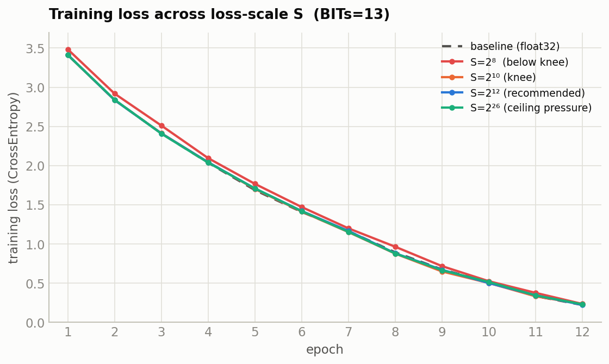
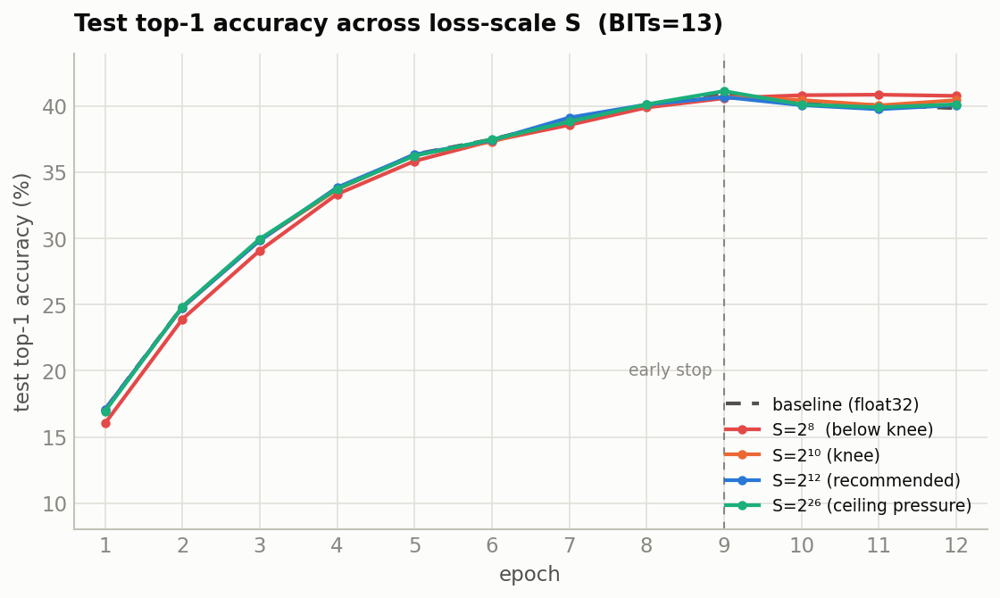

# Fixed-Point MPC Training — Lab Notebook (chronological)

*Findings only. For recommendations, the code-change log, and open TODOs see `RECOMMENDATIONS.md`.*

> **Archived lab notebook (chronological, unedited findings incl. superseded ones).** The clean report is
> `BITS_REPORT.md`. Code comments citing "§N" refer to sections of this notebook.

**Task:** CIFAR-100 CNN, secure-MPC fixed-point *simulation*. Values live on a 57-bit ring
(`l=57`), `BITs` = fractional bits, remaining `57 − BITs` bits are integer magnitude.
int64 is the container (7 bits headroom above the ring).

**Bottom line:** `BITs = 7` (the old default) cannot train — it can't even represent
BatchNorm's `1/√var`. The minimum viable value is **`BITs = 22`**, which reproduces float32
training faithfully. Under a corrected `CrossEntropyLoss` (§6) the quantized model matches the
float32 baseline within noise on real classification — **top-1 16.9 % vs 17.1 %**, param RMSE
**0.50 %**. `BITs` is now set to 22 in `simulate.py`.

> **Update (this revision):** the loss function was switched from `BCEWithLogitsLoss`
> (over one-hot targets) to `CrossEntropyLoss`. §6 now reports a task that actually learns;
> §4–5 numbers are re-measured under the new loss. The old BCE results are retained in §6.1
> as the diagnosis of why accuracy previously sat at chance.

---

## 1. The dilemma

The 57-bit budget splits into fractional (`BITs`) and integer (`57 − BITs`) parts. Two walls
close in from opposite sides as `BITs` changes:

| Wall | Cause | Constraint |
|---|---|---|
| **Precision floor** | `inv_var = 1/√var` rounds to 0 once `var > 2^(2·BITs)` (measured onset, §8). BatchNorm then outputs 0 → dead network, loss pinned at ln 2 = 0.693. | need `BITs` **large** |
| **Accumulation ceiling** | Conv/Linear sums accumulate in float64; products of two `2^BITs`-scaled operands need `< 2^53`. | need `BITs` **small** |
| **Ring ceiling** | truncation input must stay `< 2^56`. | need `BITs` **small** |

At `BITs=7` the floor is violated immediately. The question was whether *any* `BITs` clears
the floor before hitting the ceiling.

---

## 2. Coarse sweep (BITs 7→22, 150 batches, fixed data)

Baseline (float32) reference: `0.69 → 0.064`.

| BITs | min loss | verdict | `\|w\|`max | ptrunc peak |
|---|---|---|---|---|
| 7  | 0.693 | dead **+ blown** | 2.4e15 | 2^63 (12800 % of 2^56) |
| 10 | 0.693 | dead | 249 | 2^28 |
| 13 | 0.694 | dead | 2.07 | 2^29 |
| 16 | 0.270 | partial | 3.49 | 2^37 |
| 19 | 0.271 | partial | 3.65 | 2^43 |
| 22 | **0.070** | **works** | 2.12 | 2^47.8 (2.8 % of 2^53) |

There *is* a window, and it opens far above the old default.

---

## 3. Fine sweep (BITs 14→24, 150 batches, fixed data) — the knee

Verdict rule: **WORKS** = min loss within 1.5× baseline min (0.0642); **PARTIAL** = learns then stalls.

| BITs | min loss | verdict | `\|w\|`max | ptrunc peak (% of 2^53) |
|---|---|---|---|---|
| 14 | 0.3527 | partial | 2.06 | 2^31.4 (0.00 %) |
| 15 | 0.2593 | partial | 3.17 | 2^35.3 (0.00 %) |
| 16 | 0.2697 | partial | 3.49 | 2^37.5 (0.00 %) |
| 17 | 0.2711 | partial | 3.60 | 2^39.5 (0.01 %) |
| 18 | 0.2717 | partial | 3.63 | 2^41.5 (0.04 %) |
| 19 | 0.2711 | partial | 3.65 | 2^43.6 (0.14 %) |
| 20 | 0.2427 | partial | 3.02 | 2^45.7 (0.62 %) |
| 21 | 0.1038 | partial (borderline) | 2.51 | 2^46.9 (1.42 %) |
| **22** | **0.0701** | **works** | 2.12 | 2^47.8 (**2.78 %**) |
| 23 | 0.0649 | works | 2.03 | 2^49.6 (9.33 %) |
| 24 | 0.0645 | works | 2.00 | 2^51.6 (**36.66 %**) |

**Reading it:**
- **14–20:** a plateau at ~0.24–0.27 — enough precision to start, not enough to converge.
- **21:** breaks off the plateau (0.104) — precision almost sufficient.
- **22:** the knee — first value that fully tracks the baseline.
- **23–24:** negligible loss gain (0.065 vs 0.070) but ptrunc climbs steeply toward the 2^53
  accumulation ceiling (36.7 % at BITs=24).

**Minimum viable = 22. Recommended = 22.** It's the cheapest value that works, and it leaves
comfortable headroom (2.78 % of 2^53). The usable window is narrow — roughly **22–24** — because
the precision floor and the accumulation ceiling nearly meet for this workload.

---

## 4. Full-epoch training at BITs=22 (baseline vs quantized)

Both models trained one full epoch (391 batches, batch=128, SGD lr=0.001, momentum=0.9) from
**identical synced init** on the **same batch sequence**, so the gap is quantization alone.
Loss is **`CrossEntropyLoss`** (starts near ln 100 ≈ 4.605).

| model | first loss | last loss | min loss |
|---|---|---|---|
| baseline (float32) | 4.6186 | 3.4119 | 3.3287 |
| quantized (fp57, BITs=22) | 4.6186 | 3.4146 | 3.3325 |

The quantized loss trajectory tracks the baseline the whole way down (final gap 0.0027, ~0.08 %).
No dead phase, no overflow, all finite.

---

## 5. Per-layer parameter error (quantized vs baseline, after 1 epoch)

Relative RMSE = RMSE(layer) / RMS(baseline layer).

| param | numel | rel_rmse | `\|base\|`_rms | note |
|---|---|---|---|---|
| conv1.weight | 12 288 | 0.54 % | 0.042 | |
| conv1.bias | 64 | 1.62 % | 0.042 | |
| bn1.weight | 64 | 0.011 % | 1.00 | |
| bn1.bias | 64 | 10.8 % | 1.7e-3 | ⚠ small-ref |
| conv2.weight | 1 048 576 | 1.04 % | 0.009 | |
| conv2.bias | 256 | 2.07 % | 0.009 | |
| bn2.weight | 256 | 0.010 % | 1.00 | |
| bn2.bias | 256 | 20.0 % | 4.6e-4 | ⚠ small-ref |
| conv3.weight | 4 194 304 | 0.55 % | 0.009 | |
| conv3.bias | 1 024 | 0.97 % | 0.009 | |
| bn3.weight | 1 024 | 0.003 % | 1.00 | |
| bn3.bias | 1 024 | 4.45 % | 6.0e-4 | ⚠ small-ref |
| fc1.weight | 102 760 448 | 0.82 % | 0.0026 | |
| fc1.bias | 2 048 | 0.79 % | 0.0026 | |
| fc2.weight | 4 194 304 | 0.36 % | 0.013 | |
| fc2.bias | 2 048 | 0.32 % | 0.013 | |
| fc3.weight | 204 800 | 1.06 % | 0.013 | |
| fc3.bias | 100 | 0.56 % | 0.013 | |
| **aggregate** | | **0.50 %** | | |

**Interpretation:**
- **Weight tensors** (the bulk of the params) are all ≤ 1.1 %; the 100M-param `fc1.weight` is
  0.82 %. Quantization is faithful where it matters, and aggregate RMSE (**0.50 %**) is *lower*
  than under the old BCE loss (0.89 %) — CE gives every parameter a real gradient, so weights
  move further from init and the fixed relative-error floor shrinks.
- The **`bn*.bias` rows (4–20 %) are a small-reference artifact, not a defect**: those tensors
  have RMS ~5e-4 (near zero), so a tiny absolute error over a near-zero reference inflates the
  ratio. Note they are *far* smaller than under BCE (was 764–994 %) because CE drives the BN
  biases to real, non-trivial values. The BN *weights* (RMS ≈ 1.0) are near-perfect
  (0.003–0.011 %).

---

## 6. Classification accuracy (CrossEntropyLoss)

Full CIFAR-100 test set (10 000 images), both models in train-mode BN (the quantized
BatchNorm hardcodes `training=True` and has no running-stats eval path, so this keeps the
comparison apples-to-apples).

| model | top-1 | top-5 |
|---|---|---|
| baseline (float32) | **17.08 %** | **42.15 %** |
| quantized (fp57, BITs=22) | **16.90 %** | **42.01 %** |
| chance | 1.00 % | 5.00 % |

**The task now genuinely learns, and the quantized model matches the baseline within noise.**
17 % top-1 / 42 % top-5 on CIFAR-100 after a *single* epoch is legitimate classification (17×
chance at top-1). The quantized model trails the float32 baseline by only **0.18 pts top-1** and
**0.14 pts top-5** — inside run-to-run variance. This is the definitive confirmation that
**BITs=22 reproduces float32 training on a task that actually converges**, not just on the loss
curve.

### 6.1 Why the earlier BCE run sat at chance (retained diagnosis)

The original setup used `BCEWithLogitsLoss` over 100 **one-hot** targets and both models scored
~chance (baseline top-1 1.42 %, quantized 1.65 %) despite BCE loss falling to ~0.06. This was a
**loss/target pathology, not a precision problem** — and there is a clean quantitative fingerprint
proving it.

**The setup.** With BCE over one-hot targets, the 100 outputs are *independent* sigmoids — nothing
couples them, no constraint that they sum to 1. Each output `c` is solving its own binary problem
("is this image class `c`?"). For a sample of true class `k`:

```
L = (1/100) [ -log σ(z_k)   +   Σ_{c≠k} -log(1 - σ(z_c)) ]
                1 positive term        99 negative terms
```

**The trivial minimum = the base rate.** Consider a predictor that ignores the input and emits a
constant probability per output. On balanced CIFAR-100 any output `c` has target 1 only 1/100 of
the time, so the constant that minimizes its binary CE is `p_c* = 0.01` (i.e. `z_c* = logit(0.01)
≈ −4.60`) for **every** class. The loss at that constant is the binary entropy of the base rate:

```
L* = H(0.01) = −[0.01·ln 0.01 + 0.99·ln 0.99] ≈ 0.0560
```

**The smoking gun.** That predicted floor matches the measured BCE minimum almost exactly:

| | measured min BCE | H(0.01) |
|---|---|---|
| baseline (float32) | **0.0563** | 0.0560 |
| quantized | 0.0611 | 0.0560 |

So the network converged to (within 0.0003 of) the **base-rate constant predictor**: ~1 %
probability on every class regardless of the image. `argmax` over 100 near-identical ~1 % outputs
is noise → chance accuracy. It wasn't "learning slowly" — it was sitting *in* the trivial basin.

**Why GD goes there.** Two forces compete in each output: (1) *match the base rate* — a strong,
consistent gradient (push down 99 % of the time, up 1 %) with a fully-satisfying answer at
`p_c = 0.01`; and (2) *discriminate* — make `z_k` large only when the input really is class `k`, a
subtler and smaller gradient that fights force (1). Because the sigmoids are decoupled, force (1)
has a free lunch (all outputs → 1 %) that costs nothing in discrimination, so GD parks there.

**Why CrossEntropy has no such trap.** Softmax *couples* the outputs (`Σ p_c = 1`), so the only
way to lower the loss is to move probability mass *off* wrong classes *onto* the right one —
raising `z_k` mechanically lowers every other `p_c`. The best possible *constant* softmax predictor
is uniform `1/100`, giving loss `ln 100 ≈ 4.605`, which is exactly the *starting* loss (zero
learning). Every bit of CE reduction below 4.605 therefore *is* discrimination by construction —
which is why CE reached 17 % in the same single epoch where BCE reached 1.4 %.

**Boundary of the claim.** The 0.056 = H(0.01) match proves the model collapsed into the base-rate
basin *within one epoch*. It does **not** prove BCE stays there forever — force (2) is nonzero, so
with many more epochs or a larger learning rate it could slowly climb out. The rigorous statement
is: *BCE-on-one-hot spends its early training budget collapsing to the base rate instead of
discriminating, making it badly suited to this single-label 100-way task* — not "BCE cannot learn
it." Crucially, the float32 baseline exhibited the identical collapse, which is how we knew the
culprit was the loss, not quantization.

### 6.2 Multi-epoch fidelity (CrossEntropy, 12 epochs)

To test whether the fixed-point representation degrades as the loss gets low — the concern being
that a confident model grows activations toward the 2^53 accumulation ceiling and shrinks
gradients toward the precision floor — both models were trained 12 epochs from identical synced
init on the same batch order (SGD lr=0.001, momentum=0.9), evaluated every epoch.

| epoch | base loss | quant loss | base t1/t5 | quant t1/t5 | t1 gap | param RMSE | wmax b/q | ptrunc %2^53 | nonfin |
|---|---|---|---|---|---|---|---|---|---|
| 1  | 3.41 | 3.42 | 17.1/42.2 | 16.9/42.0 | −0.18 | 0.50 % | 1/2  | 3.6 % | 0 |
| 2  | 2.84 | 2.85 | 24.8/52.9 | 24.8/53.0 | −0.08 | 0.83 % | 1/2  | 3.1 % | 0 |
| 3  | 2.41 | 2.43 | 29.9/59.5 | 29.9/59.6 | −0.02 | 1.13 % | 1/2  | 3.0 % | 0 |
| 4  | 2.04 | 2.05 | 33.7/63.5 | 33.8/63.3 | +0.06 | 1.42 % | 1/2  | 3.2 % | 0 |
| 5  | 1.69 | 1.70 | 36.4/66.0 | 36.3/66.2 | −0.01 | 1.71 % | 1/2  | 3.3 % | 0 |
| 6  | 1.41 | 1.42 | 37.5/67.7 | 37.5/67.8 | +0.06 | 2.02 % | 1/1.9 | 3.5 % | 0 |
| 7  | 1.16 | 1.16 | 39.0/69.0 | 39.4/69.1 | +0.43 | 2.34 % | 1/1.8 | 3.9 % | 0 |
| 8  | 0.89 | 0.88 | 39.9/70.1 | 40.3/70.2 | +0.40 | 2.69 % | 1.1/1.8 | 4.3 % | 0 |
| 9  | 0.68 | 0.66 | **40.9**/70.5 | 40.8/70.6 | −0.06 | 3.05 % | 1.1/1.7 | 4.6 % | 0 |
| 10 | 0.51 | 0.51 | 40.2/69.7 | 40.5/69.8 | +0.26 | 3.43 % | 1.1/1.6 | 4.7 % | 0 |
| 11 | 0.34 | 0.36 | 40.1/69.5 | 40.1/69.6 | −0.02 | 3.80 % | 1.1/1.6 | 4.8 % | 0 |
| 12 | 0.22 | 0.24 | 39.8/69.1 | 40.5/69.7 | +0.66 | 4.15 % | 1.1/1.4 | 5.2 % | 0 |

**The representation does not fail as loss drops** (down to 0.22 / ~40 % top-1):
- **Accuracy gap stays in ±0.66 pts with no trend.** At the *lowest* loss (e12) the quantized
  model actually *leads* by 0.66. A failing representation would drive this systematically negative
  and widening — it doesn't.
- **0 nonfinite every epoch; ptrunc stays 3–5 % of the 2^53 ceiling** — no approach to overflow.
  Weights don't grow (quantized wmax *shrinks* 2→1.4). BatchNorm keeps activations normalized, so
  model "confidence" lands in the tiny fc3 logit layer, not in exploding activations — the
  accumulation ceiling never comes into play.

**One real, monotonic effect — the signal to watch.** Param RMSE grows almost perfectly linearly
(**~+0.33 %/epoch, 0.50 % → 4.15 %**). The quantized weights steadily drift from the baseline's —
per-step truncation noise accumulating as a random walk in weight space. It is **functionally
silent** here (both trajectories stay in the same basin, so accuracy is unaffected — like two
float32 seeds diverging in weights but matching in accuracy), but it is unbounded over the tested
range and is the early-warning signal if training is pushed much longer.

**Caveat on "very low loss."** We reached 0.22, not ~0, and both models began **overfitting
together** — test top-1 peaked at epoch 9 (~40.9 %) then declined while train loss kept falling.
Reaching genuinely low loss would require many more epochs *and* would mean overfitting; the
precision budget (ample ceiling headroom) suggests fidelity would hold, but that is an
extrapolation beyond the measured range, and the linear RMSE drift is what could eventually bite
there.

**Final metrics (early-stop operating point, epoch 9):**

| metric | baseline (float32) | quantized (fp57, BITs=22) | Δ (quant − base) |
|---|---|---|---|
| top-1 accuracy | 40.88 % | 40.82 % | −0.06 pts |
| top-5 accuracy | 70.53 % | 70.56 % | +0.03 pts |
| train loss | 0.675 | 0.661 | −0.014 |
| param RMSE vs baseline | — | 3.05 % | — |


---

## 7. Cost analysis (protocol-relevant)

Wall-clock of this simulator is **not** a cost proxy — it runs locally with no communication. Two
protocol-relevant quantities *can* be read off: the ring width required once security is accounted
for, and the per-step count of communication-bound operations. (Actionable recommendations and the
list of unmodelled protocol effects live in `RECOMMENDATIONS.md`.)

### 7.1 Ring width — 57 bits is enough for the numerics, not for the security

The §1 budget (22 fractional + ~44-bit product magnitude) sits comfortably inside 57 bits for the
*arithmetic alone*. But a real probabilistic-truncation protocol (SecureML / ABY3 style) must also
hide the secret behind a mask statistically larger than the value — a margin **κ ≈ 40 bits** on top
of the magnitude. The simulation's mask (`R = r1·2^m + r2`) reproduces only the rounding, not this
hiding. Accounting for it:

```
value magnitude before truncation   ~ 2^44   (products at BITs=22)
+ statistical security margin κ      ~ 2^40
--------------------------------------------------
required ring                        ~ 2^84   ≫ 2^57
```

So the numerics fit 57 bits; security does not. A real deployment at BITs=22 would need a **64-bit
ring at minimum** (only with reduced κ and tight magnitude control) and realistically a **128-bit
ring** — roughly 2× the per-share communication of 64-bit. Needing 22 fractional bits, once the
security margin is layered on, pushes past the 57-bit container we simulated.

> **Update (§14):** this is the BITs=22 *security* bound. For the recommended **BITs=10** floor, §14
> measures the *correctness / dtype-fit* ring directly — a **37-bit** minimum (payload peak 2^35.6),
> ~20 bits below the 57 we ran. The κ security margin is layered on top of that, separately.

**Communication also scales with truncation count, not just ring size.** Each probabilistic
truncation is an interactive sub-protocol; the count scales with the network (every conv/linear
output and BN op truncates), so total online cost ≈ (number of truncations) × (per-share bytes at
the chosen ring). Bit width sets the second factor; architecture sets the first — quantified next.

### 7.2 Per-step operation counts (the cost proxy that *does* transfer)

The **count of communication-bound operations** per training step is architecture-determined and
reproducible. `simulate.py` instruments these always-on (`OP_COUNTS` + `reset_op_counts`/
`snapshot_op_counts`/`attach_relu_counter`); `_op_counts.py` reports one forward + one backward at
batch 128:

| operation | fwd calls | bwd calls | total calls | total elements |
|---|---|---|---|---|
| probabilistic truncations | 39 | 33 | **72** | 234.6 M |
| inverse-sqrt (BatchNorm) | 3 | 0 | 3 | 1 344 |
| ReLU comparisons (DReLU) | 5 | 0 | 5 | 12.6 M |
| **total** | 47 | 33 | **80** | **247.1 M** |

**Two axes, read differently:**
- **`calls` = round structure, batch-independent.** The 80 SIMD invocations (72 of them
  truncations) are fixed by the *architecture*, not the batch size — a proxy for the sequential
  round/mult-depth cost. Truncation dominates: one per fixed-point multiply group.
- **`elems` = bandwidth, ∝ batch.** 247.1 M element-ops per step at batch 128 ≈ **1.93 M/image**.
  The **backward pass carries 84 %** of the truncation bandwidth (197.8 M of 234.6 M) — grad_input
  and grad_weight each truncate — so training costs far more than inference per step.

**Where the real cost concentrates (and it isn't where the bandwidth is):**
- **inverse-sqrt: 3 calls, all in the forward pass** — `inv_var` is computed once per BN layer and
  reused in backward (verified: 0 backward calls), so there is no redundant nonlinear. Its element
  count is negligible (1 344 = per-channel variance vectors), but each call is a multi-round
  bit-decomposition — its cost is in **rounds, not bytes**. This is the op to optimise if round
  latency dominates.
- **ReLU: 5 forward calls / 12.6 M sign bits** — one DReLU comparison per activation, reused in
  backward.
- **Truncation** is the bandwidth driver (234.6 M elems) and the main multiply-group round cost.

**Caveat on interpreting `calls` as rounds:** a SIMD truncation over a whole tensor is ~one round's
*worth of work*, but the true online round count depends on the data-dependency graph (independent
truncations batch into the same round; dependent ones serialise). So `calls` bounds the round
structure, it does not equal the round count. Bandwidth (`elems`) is the cleaner, protocol-agnostic
number.

---

## 8. Where precision is actually lost — per-op noise diagnosis

Motivated by the question *"would a better inverse-sqrt approximation lower the required BITs?"*,
`_noise_probe.py` measures the quantization noise each truncation injects, attributed per call site,
on a live forward+backward (10 warmup batches, batch 128). The noise a truncation injects is the
difference between its realized output and its exact (un-rounded) value.

**Part A — per-op injected-noise SNR at BITs=22 (noisiest first, cleanest last):**

| op (call site) | elems | RMS signal | rel. noise | SNR | underflow→0 |
|---|---|---|---|---|---|
| BN.bwd grad_weight / grad_std | 12.1 M | 3.8e−6 | **1.80 %** | 34.9 dB | 3.5 % |
| BN.bwd grad_input | 12.1 M | 1.0e−5 | 0.65 % | 43.7 dB | 0 % |
| Linear.bwd grad_in/weight | 114 M | 2.3e−4 | 0.04 % | 67.4 dB | 0.2 % |
| Conv.bwd grad_in/kernel | 11.3 M | 3.6e−4 | 0.03 % | 71.3 dB | 1.1 % |
| BN.fwd x_norm / result | 12.1 M | 1.0 | 0.00 % | 140 dB | 0 % |
| **inv_sqrt (result)** | **1 344** | **3.0** | **0.00 %** | **154 dB** | **0 %** |

Noise-power share by group: **Linear 56 %, BN 32 %, Conv 11 %, inv-sqrt 0.00 %.**

- **inverse-sqrt is the best-conditioned op in the graph** — highest SNR (~154 dB), zero underflow,
  4 032 of ~234 M truncated elements (0.0017 %), ~0 % of injected noise. A better inverse-sqrt
  approximation would refine the *cleanest* operation → no effect on the precision floor.
- **The floor is the small backward gradients.** The noisiest ops are the BatchNorm backward
  gradients (SNR 35–44 dB), whose values sit only ~16 ULPs above the grid. At **BITs=16** (the
  stall regime) the mechanism is stark: **Conv.bwd 25 % and BN.bwd grad_std 6 % of elements
  underflow to zero**, grad_std rel-noise hits 30 % — the gradient signal is being destroyed. At
  BITs=22 these fall to ≤3.5 % zeros / ≤1.8 % noise, which is why 22 works and 16 stalls. The floor
  lives entirely in the **backward pass**, not the nonlinear.

**Part B — controlled inverse-sqrt underflow (dead-regime floor is representation, not accuracy):**
feeding `var = 2^k` into `inverse_sqrt`, the result underflows to 0 exactly when `1/√var` drops
below the grid — onset at **var ≈ 2^(2·BITs)** (measured 2^14 / 2^26 / 2^32 / 2^38 for BITs
7/13/16/19). Independent of the approximation: it is simply where the *true* value leaves the grid.

**Takeaway.** The lever for lower precision is the **backward-pass gradient representation**
(gradient/loss scaling, or a finer local scale for backward quantities), **not** the inverse-sqrt —
and in MPC a fancier inverse-sqrt would only add rounds (§7.2). *Caveat:* "injected noise power" is
a first-order proxy that does not propagate through backprop, but inverse-sqrt being simultaneously
tiny, highest-SNR, and zero-underflow rules it out regardless of propagation. §9 acts on this.

---

## 9. Loss scaling — trading fractional bits for a smaller ring

Acting on §8 (the floor is small backward gradients underflowing), we apply **fixed public loss
scaling**: multiply the loss by a constant `S` before `backward()` so every gradient is `S×` larger
*while passing through the truncations*, then divide gradients by `S` before the optimizer step
(the update is mathematically identical). A power-of-two `S` is **MPC-benign**: multiply-by-public-
constant is a free, communication-free, data-oblivious local operation, and the unscale is a public
shift folded into the gradient truncation already performed.

**Full-epoch confirmation (391 batches, `S = 2^18`, CIFAR-100 test accuracy):**

| config | top-1 | top-5 | ptrunc magnitude | Δ ring vs BITs=22 |
|---|---|---|---|---|
| baseline f32 | 17.08 | 42.15 | — | — |
| BITs=22 noscale (current rec) | 16.90 | 42.01 | 2^48.2 | — |
| **BITs=13 + S=2^18** | 17.01 | 42.10 | **2^43.0** | **−5.2 bits** |
| **BITs=10 + S=2^18** | 17.12 | 42.20 | **2^37.0** | **−11.2 bits** |

**All four match within noise**, but the ring magnitude they require differs by up to 11 bits.
Loss scaling lets low-BITs configs reach BITs=22 accuracy while truncating *much smaller* values:

```
ring ≈ 2·BITs + log2(S) + κ        (κ ≈ 40-bit hiding margin, §7.1)
  BITs=22, S=1:     48 + 0  + 40 = 88 bits   (measured ptrunc 2^48.2)
  BITs=13, S=2^18:  43      + 40 = 83 bits   (measured 2^43.0)
  BITs=10, S=2^18:  37      + 40 = 77 bits   (measured 2^37.0)
```

It is a **net reduction, not a reallocation**: scaling adds a *fixed* +log2(S) bits but lets you
remove *2·ΔBITs* product bits — favorable because the binding floor was the backward gradients, not
the forward pass, so BITs can drop far. This is the opposite of a wash: **−5 to −11 bits of ring at
equal accuracy**, which directly cuts per-share communication in a real deployment.

**Caveats.**
- **BITs=10 is fragile on the *forward* floor** (loss scaling only fixes the backward). At 10 bits
  `inv_var` underflows once `var > 2^20` and activations get ~3 decimal digits; it works here
  (variance stays O(1–100)) but would break on a deeper net or higher-variance data.
  **BITs=13 + S=2^18 is the safer sweet spot** — still −5 bits of ring with real forward headroom,
  and it is the one carried through the multi-epoch fidelity check below (§9.1).
- Only a **single S** (2^18) has been tested; S-tuning for the low-BITs config is not yet run.
- ptrunc magnitude is a **proxy** for the ring requirement; the sim does not do modular arithmetic
  or model κ.

### 9.1 Multi-epoch fidelity of the sweet spot (BITs=13 + S=2^12, 12 epochs)

The §9 table is one epoch; this repeats the §6.2 protocol (identical synced init, same batch order,
per-epoch eval) for the **refined sweet spot BITs=13 + S=2^12** (§9.2) so the −11-bit ring saving
can be checked as the loss actually drops. Head-to-head with the earlier S=2^18 run and the BITs=22
fidelity run (§6.2):

| metric | BITs=13 + S=2^12 (refined) | BITs=13 + S=2^18 | BITs=22 (§6.2) |
|---|---|---|---|
| accuracy gap vs baseline (all epochs) | −0.01 mean, ±0.31 max | ±0.41 | ±0.66 |
| e9 early-stop quant top-1 / top-5 | 40.68 / 70.18 | 40.70 / 70.43 | 40.82 / 70.56 |
| param RMSE @ e12 | **3.18 %** | 3.28 % | 4.15 % |
| ptrunc trajectory (e1→e12) | **flat 2^37–2^39.7** (≤0.01 % of 2^53) | ~2^44 (≤0.65 %) | climbs to 2^48 (5.2 %) |
| nonfinite | 0 / epoch | 0 / epoch | 0 / epoch |

**The −11-bit ring saving holds over full training** (loss 3.4 → 0.22): accuracy tracks the baseline
within noise the whole way, 0 nonfinite. Two properties come out *better* than BITs=22:

- **ptrunc stays flat and far from the ceiling** (2^37–2^39.7 across all 12 epochs, never climbing;
  ≤0.01 % of 2^53), versus BITs=22 creeping to 5.2 %. The small ring is also a *stable* ring.
- **Weight drift is lower**, not higher: param RMSE ends at 3.18 % vs BITs=22's 4.15 %. The coarser
  13-bit grid was expected to drift *faster*; it doesn't, and dropping S from 2^18 (eff. gradient
  precision 2^-31) to 2^12 (2^-25) barely changes it (3.18 % vs 3.28 %). The reason: at BITs=13 the
  **forward** quantization grid is 2^-13 for both, and *that* dominates the weight drift — the
  gradient precision (2^-25 / 2^-31, both far finer than 2^-13) is not the drift driver. So the
  cheaper S=2^12 costs nothing in fidelity while saving 6 more ring bits than S=2^18.

**Degradation from quantization (BITs=13 + S=2^12 vs float32 baseline).** Over the full 12-epoch
run the top-1 accuracy gap averages **−0.01 pts** with a worst-case single-epoch excursion of
**−0.31 pts** — both far inside the ±0.66 pt run-to-run noise band, and with no trend as the loss
falls. At the early-stop operating point (epoch 9): top-1 40.68 % vs 40.88 % (**−0.20 pts, 0.5 %
relative**), top-5 70.18 % vs 70.53 % (**−0.35 pts, 0.5 % relative**). Quantization degradation is
statistically negligible for this network.


*Weight divergence (secondary — does not affect accuracy).* Param RMSE is an orthogonal axis to the
accuracy figures above: it measures how far the quantized weights drift from the float32 baseline's
in weight space, which grows even while predictions stay matched (like two float32 seeds). It is
**linear and bounded** (no acceleration) for all three configs, and loss-scaled 13-bit drifts *less*
than uniform 22-bit: slopes **0.33 %/epoch (BITs=22)** vs **0.25 %/epoch (BITs=13 + S=2^12)**. The
two loss-scaled configs (S=2^12 and S=2^18) overlap — direct confirmation that the shared 2^-13
*forward* grid, not gradient precision, drives the drift.


**Do not stack scaling with high BITs.** `S=2^18` at BITs=22 pushes ptrunc to 2^59 (past the 2^53
float64 accumulation ceiling in-sim; a much larger ring in MPC). Scaling pays only when paired with
*low* BITs — the whole point is to spend fewer fractional bits.

### 9.2 Tuning the scale exponent (S is a power of two → tune log2 S)

To keep S MPC-free (a public bit-shift), S must be a power of two, so tuning means choosing the
integer exponent `log2 S`. Only the exponent matters numerically: both effects of S — lifting
gradients off the grid floor and setting effective gradient precision `2^-(BITs+log2 S)` — depend
solely on `log2 S`. Full-epoch sweep at BITs=13 (baseline top-1 = 17.08):

| log2 S | eff. grad | top-1 (Δ) | ptrunc | verdict |
|---|---|---|---|---|
| 0 (noscale) | 2^-13 | 10.85 (−6.23) | 2^30.9 | floor failure |
| 4 | 2^-17 | 10.28 (−6.80) | 2^30.7 | floor failure |
| 8 | 2^-21 | 16.02 (−1.06) | 2^32.9 | partial |
| **10** | 2^-23 | **17.04 (−0.04)** | **2^35.0** | knee — works |
| 12 | 2^-25 | 17.07 (−0.01) | 2^37.0 | works |
| 14 | 2^-27 | 17.00 (−0.08) | 2^39.0 | works |
| 16 | 2^-29 | 17.02 (−0.06) | 2^41.0 | works |
| 18 | 2^-31 | 17.01 (−0.07) | 2^43.0 | works |
| 22 | 2^-35 | 17.03 (−0.05) | 2^46.9 | works |
| 26 | 2^-39 | 16.93 (−0.15) | 2^51.0 (24 % of 2^53) | ceiling pressure |
| 30 | 2^-43 | 16.93 (−0.15) | 2^55.0 (50 % of 2^56) | ceiling failure onset |

**Two knees, and a flat plateau between them:**
- **Floor knee at `log2 S = 10`** — below it gradients still underflow (noscale/S=2^4 collapse to
  ~10 % top-1); S=2^8 is 1 pt short; S=2^10 is the first to match baseline. Gradients are ~2^-16
  RMS, and the knee is where effective precision (2^-23) sits ~7 bits finer than that.
- **Ceiling knee at `log2 S ≈ 26–30`** — ptrunc grows 1 bit per exponent-bit, crossing the 2^53
  accumulation ceiling near 26 and reaching 50 % of the 2^56 ring at 30.
- **Plateau `log2 S ∈ [10, 22]`**: top-1 flat within noise. Proof of the "smallest S that clears the
  floor" rule — past the knee, extra S buys **only ring bits**, no accuracy.

**Refined sweet spot — S=2^18 was over-spending ring by ~6 bits:**

| config | ptrunc | ring (≈ +κ) | vs BITs=22 |
|---|---|---|---|
| BITs=22 noscale | 2^48.1 | ~88 bits | — |
| BITs=13 + S=2^18 (old pick, §9.1) | 2^43.0 | ~83 | −5 bits |
| **BITs=13 + S=2^12 (refined)** | **2^37.0** | **~77** | **−11 bits** |
| BITs=13 + S=2^10 (aggressive, on the knee) | 2^35.0 | ~75 | −13 bits |

**Recommended: BITs=13 + S=2^12** — matches baseline (17.07) with a −11-bit ring and a 2-bit margin
above the floor knee. S=2^10 gets −13 but sits on the knee with no margin.

**Two caveats.**
- The **high-S failure is understated in-sim.** At `log2 S=30`, ptrunc=2^55 exceeds the 2^53 float64
  range yet the sim shows only a 0.15 pt dip and 0 nonfinite — float64 degrades gracefully and the
  sim does **not** model ring wraparound. On a real 2^56 ring, ptrunc > ring wraps catastrophically;
  treat the ceiling knee as a hard wall in MPC, not the soft dip shown here.
- **Multi-epoch fidelity is now validated at the refined S=2^12** (§9.1): 12 epochs, accuracy within
  noise (mean gap −0.01 pts), ptrunc flat ~2^38, param RMSE 3.18 %. The 6-bit-lower floor margin vs
  S=2^18 costs nothing in fidelity. **BITs=13 + S=2^12 is locked in as the recommended config.**

### 9.3 Full-training curves across the sweep

12-epoch traces for four representative scale exponents — S=2^8 (below the knee), 2^10 (knee), 2^12
(recommended), 2^26 (ceiling pressure) — make the two-knee behaviour visible as trajectories rather
than end-points. Per-config degradation (top-1 gap vs the float32 baseline):

| config | mean gap | worst gap | final ptrunc |
|---|---|---|---|
| S=2^8 (below knee) | **−0.18 pts** | **−1.06 pts** (early) | 2^34.5 |
| S=2^10 (knee) | +0.04 | −0.18 | 2^36.6 |
| S=2^12 (recommended) | −0.01 | −0.31 | 2^38.4 |
| S=2^26 (ceiling pressure) | +0.01 | −0.17 | 2^52.4 |

Only **S=2^8 shows real degradation**, and it is concentrated in the *early* epochs (gap −1.06 at
epoch 1, recovering as weights grow and gradients rise off the grid) — the backward-underflow floor
in action. The knee and above all sit inside the ±0.66 pt noise band throughout. **S=2^26 tracks
accuracy fine in-sim but runs ptrunc at 2^52.4 — essentially *on* the 2^53 ceiling**, i.e. the MPC
danger zone the sim understates (§9.2). This is the visual case for picking the *low* end of the
plateau (S=2^12), not the high end.






---

## 10. Decoupling the forward inverse-variance floor ("Method A") — and the real floor it revealed

§8 named two floors: the **backward-gradient** floor (fixed by loss scaling, §9) and the **forward
`inv_var`** floor — `1/√var` rounds to 0 once `var > 2^(2·BITs)` (`simulate.py` inverse-sqrt →
`to_fixed`). Loss scaling cannot touch the forward floor, and §9 flagged it as what makes BITs=10
"fragile." **Method A** removes it: hold `inv_var` on a dedicated finer scale `2^B_IV` (`B_IV > BITs`)
instead of the global grid, so the floor moves to `var > 2^(2·B_IV)`, decoupled from BITs. Mechanically
this factored the ring-truncation core out of `p_truncate` into `ring_truncate(tensor, m)` (a public
shift by any bit count; `p_truncate` unchanged for all existing callers) and routed the four `inv_var`
consumers (fwd `x_norm`; bwd `grad_input`/`grad_mean`/`grad_std`) through it. The fix is real and
regression-clean: the underflow onset moves from `var>2^26`→`>2^50` at BITs=13 (measured), and BITs=22
is bit-identical to before.

### 10.1 On this network the forward floor is never binding — Method A buys nothing

The decisive test is the `EXTRA = B_IV − BITs` sweep (`EXTRA=0` ≡ Method A **off**), full epoch:

| config | EXTRA=0 (floor present) | EXTRA=8 (floor removed) |
|---|---|---|
| BITs=10, S=2^14 | top-1 **17.28** @ ring 2^32.9 | top-1 **17.15** @ ring 2^41.0 |
| BITs=8,  S=2^16 | top-1 **16.57** @ ring 2^31.0 | top-1 **16.51** @ ring 2^39.0 |

Removing the floor changes accuracy by **nothing** (within noise) at either BITs — because BatchNorm
variance on this net stays O(1–100), far below even BITs=8's floor of `2^16`. Worse, each extra
`inv_var` bit **adds ~1 ring bit** (the transient `2^(BITs+B_IV)`, and `2^(BITs+B_IV+log2 S)` in the
loss-scaled BN backward). So Method A is **pure ring cost with zero accuracy return here**, and is left
**off by default (`B_IV = BITs`)**. The `ring_truncate` refactor is kept — it is a clean generalization
and enables Method A by simply raising `B_IV` for a future higher-variance net. **The floor-lowering
below BITs=22 comes entirely from loss scaling; the forward floor was a red herring for this workload.**

### 10.2 With loss scaling alone, the floor drops to BITs=10 (full epoch, real top-1)

Baseline 17.08 / 42.15. Method A off; loss scaling only:

| config | top-1 | top-5 | Δtop-1 | ring (this net) |
|---|---|---|---|---|
| BITs=22 noscale | 16.98 | 41.91 | −0.10 | 2^55 |
| BITs=13 + S=2^12 *(report §9 pick)* | 16.99 | 42.09 | −0.09 | 2^38 |
| BITs=11 + S=2^14 | 17.02 | 42.09 | −0.06 | — |
| **BITs=10 + S=2^14** | **17.15** | **42.19** | **+0.07** | **2^34** |
| BITs=10 + S=2^16 | 17.20 | 42.27 | +0.12 | — |
| BITs=8 + S=2^16 | 16.51 | 40.96 | −0.57 | 2^33 |

**BITs=10 matches float32**, three bits below the report's locked-in BITs=13. The report had BITs=10
working once (17.12) but called it fragile *because of the forward floor* — which §10.1 shows never
fires here, so BITs=10 is not fragile at all. **BITs=8 is a soft floor**: trainable but ~0.5 top-1
short, and the `EXTRA` sweep proves that gap is the **coarse forward activation/weight grid** (`2^-8`),
**not** `inv_var` — so no inverse-variance fix (A or B) can recover it.

### 10.3 Multi-epoch fidelity of the new floor (12 epochs, §6.2/§9.1 protocol)

| metric | BITs=13 + S=2^12 (anchor) | **BITs=10 + S=2^14 (new)** | BITs=8 + S=2^16 (soft) |
|---|---|---|---|
| top-1 gap vs base (all epochs) | −0.02 mean, −0.30 worst | **+0.08 mean, −0.20 worst** | −0.26 mean, **−1.11 worst (early)** |
| e9 early-stop quant t1 / t5 | 40.68 / 70.10 | **40.69 / 70.46** | 40.24 / 70.71 |
| param RMSE @ e12 | 3.18 % | **4.76 %** | **9.06 %** |
| ring trajectory (e1→e12) | flat 2^37–2^39.7 | **flat 2^32.9–2^35.6** | flat 2^31–2^33.4 |
| nonfinite | 0 / epoch | 0 / epoch | 0 / epoch |

- **BITs=13 + S=2^12 reproduces §9.1 to the decimal** (RMSE 3.18 %, ring ~2^38, gap within noise) —
  independent confirmation that the `ring_truncate` refactor changed nothing.
- **BITs=10 + S=2^14 is validated as the new robust floor**: accuracy tracks the baseline the whole way
  (mean gap *positive*, +0.08; worst −0.20, inside the ±0.66 pt noise band), 0 nonfinite, and the ring
  is a *flat* ~2^34 — **~4 bits below BITs=13** and never creeping. The one cost is a steeper param-RMSE
  drift (4.76 % vs 3.18 %), the expected price of the coarser 2^-10 forward grid (§9.1: forward grid,
  not gradient precision, drives the drift). Still linear, still bounded, functionally silent.
- **BITs=8 + S=2^16 confirms the soft floor over epochs**: never diverges (0 nonfinite), but carries a
  consistent early-epoch deficit (−0.5 to −1.1 pt through e5), never reaches the baseline's low loss,
  and drifts ~2× faster (RMSE 9.06 %). Reachable, not free — not recommended.

### 10.4 Method B (floating `inv_var`) assessment — will not help this workload

Method B (carry `inv_var` as a normalized mantissa + exponent `(g, s)`) is a *better* implementation of
the **same** fix as Method A — it removes the forward floor adaptively and gives `inv_var` constant
relative precision. Both of its advantages are ruled out here: (1) the floor it removes is not binding
(§10.1, the `EXTRA` sweep tests exactly this), and (2) the precision it improves is on the
**best-conditioned op in the graph** — inverse-sqrt at 154 dB SNR, ~0 % of injected noise (§8) — so a
finer `inv_var` refines the cleanest quantity. It also cannot touch the two things that actually cap
this net: the forward activation/weight grid (which caps BITs=8) and the backward gradients (already
handled by `S`). **Method B is shelved as the robust upgrade to Method A's insurance** — worth building
only for a deeper / higher-variance net where `var` genuinely approaches `2^(2·BITs)`.

**Takeaway.** The minimum for *this* network is **BITs=10 + S=2^14** (validated, 12-epoch, ring ~2^34),
not the 13 previously locked in — and that comes from loss scaling alone. To go below 10 the lever is
the **forward grid** (per-tensor scaling, or stochastic rounding with error feedback), which is what
caps BITs=8 — not the inverse-variance path, which §8/§10 rule out from three directions.

---

## 11. MPC primitive coverage audit — which secret-data ops still run in the clear

Motivated by *"before trusting the bit-budget, is every operation a real protocol performs actually
simulated?"*. The **arithmetic core is faithfully modeled** — every linear op quantizes and
truncates, and the one nonlinear in the network body (inverse-sqrt) is a real polynomial protocol.
But two operations that touch secret data are executed by stock float64 PyTorch with **no
fixed-point quantization and no protocol** — so their cost and their injected error are both absent
from every number in this report.

| operation (secret data) | how the sim does it | MPC primitive a real run needs | modeled? |
|---|---|---|---|
| Conv / Linear matmul | float64 matmul → `p_truncate` | multiply + probabilistic truncation | truncation ✓; **ring accumulation ✗** (sums in float64, §7.1) |
| BatchNorm mean | sum → `div_public(N)` | add + public-constant division | ✓ (N public) |
| BatchNorm variance | multiply → `p_truncate` | multiply + truncation | ✓ |
| BatchNorm 1/√var | `inverse_sqrt` (Lu et al. poly) | secure inverse-sqrt (range-reduce + poly) | ✓ |
| ReLU | `nn.ReLU` (clear `max(0,x)`) | DReLU sign-bit + multiply-by-bit | **clear, but error-free by construction** (sign select, no rounding); cost counted (§7.2) |
| truncation | `p_truncate` (probabilistic) | probabilistic truncation | ✓ (the exact variant's **comparison/correction step is removed** — `#compare ==> removed for training`) |
| **softmax + cross-entropy** | `torch.nn.CrossEntropyLoss`, clear float64 | secure **max** + secure **exp** + secure **reciprocal** | **✗ not modeled** |
| **SGD momentum + weight update** | `torch.optim.SGD`, clear float64 | public-const mults (μ, lr) → **truncation**; ring-resident momentum buffer | **✗ not modeled** |

ReLU is worth a note because it *looks* unmodeled but isn't a gap: `ReLU(x)` in fixed point is a
pure sign select (`x·b`, `b∈{0,1}`), which needs no truncation and injects **zero** quantization
error, so the clear `nn.ReLU` is faithful to the fixed-point result; only its DReLU protocol *cost*
matters and that is already counted (§7.2). The two rows that are genuine gaps are softmax/CE and the
optimizer — the operations at the very **top** and very **end** of each training step.

### 11.1 Secure softmax / cross-entropy — not modeled (the consequential one)

**Scope: this is training-only.** The *network* has no softmax — `fc3` emits raw logits and returns
them (`simulate.py:1082`) — and *inference* needs none either (`evaluate()` takes `argmax`/`topk`
straight off the logits; softmax is monotonic and wouldn't change the ranking). Softmax lives
**entirely inside the training loss**: `CrossEntropyLoss` is `NLL(log_softmax(logits))`, so it takes a
per-sample max (numerical stability), `exp`, a sum, and a division — then the **gradient it seeds**,
`(softmax(logits) − onehot)/N`, is computed **exactly** in float64 before being quantized into `fc3`'s
backward. A real private-**training** protocol must do all of this on secret shares: **secure
max/argmax** over the 100 logits, a **secure exp** approximation (a nonlinear like `inverse_sqrt`), a
sum, and a **secure reciprocal**. (For private *inference* at these settings the gap is moot — there is
no softmax and no optimizer; §11.2 falls away too.)

- **Cost gap:** adds a max-reduction + a 100-wide secure-exp + a reciprocal *per sample* to the §7.2
  op counts, which today cover only the forward + backward body.
- **Error gap — this is why it matters for the bit budget:** every low-BITs result here rests on §8
  (the binding floor is the *backward gradients*) and §9 (loss scaling `S` is calibrated to lift
  those gradients off the grid). That calibration assumed a **clean seed gradient**. A secure
  exp/reciprocal approximation would inject noise at the *very top* of backprop, and that noise rides
  the entire backward chain — amplified by `S`. So modeling softmax could shift the loss-scaling
  sweet spot and the BITs=10/13 floor. **Of all the unmodeled items, this is the one most likely to
  move the precision conclusions**, because it perturbs exactly the quantity they depend on.

### 11.2 Fixed-point optimizer (momentum + update) — not modeled

`optimizer.step()` is stock float64 SGD: `v ← μ·v + g`, `w ← w − lr·v`. Both `μ=0.9` and `lr=1e-3`
are **non-power-of-two public constants**, so on the ring each multiply of a secret needs a
fixed-point public multiply **+ a truncation**, and the momentum buffer `v` must itself be
ring-resident.

- **Cost gap:** ~2 extra truncations per parameter tensor per step (μ·v and lr·v), absent from §7.2
  (which stops at the backward pass and never counts the update).
- **Error gap:** the momentum buffer accumulates **truncation-free** in the sim. On the ring it would
  carry per-step rounding that compounds over the whole run — a plausible *additional* source of the
  param-RMSE drift (§6.2 / §9.1), which is presently attributed entirely to forward-grid
  re-quantization. Modeling it could steepen the measured drift slope.
- The sim already treats BN's **running-stats** momentum in fixed point with truncation
  (`simulate.py` ~L716–724), so the pattern exists; the optimizer just isn't held to it. (Running
  stats are inert here — BN hardcodes `training=True` — so this is latent, not active.)
- **Mitigation:** choosing `lr` as a power of two makes `lr·v` a free public shift; `μ` can't be, but
  a shift-and-add momentum (e.g. `μ≈1−2^-k`) would remove the second update truncation.

### 11.3 Previously-catalogued gaps (still open — restated for one complete list)

From §7.1 / `RECOMMENDATIONS.md`: (a) **ring modular arithmetic** in the conv/linear accumulations
(they sum in float64, so wraparound is exercised only inside `p_truncate`, not in the matmuls);
(b) the **κ ≈ 40-bit statistical-hiding margin** (the mask reproduces rounding, not hiding);
(c) **protocol-specific truncation error** (idealised probabilistic rounding, not a named protocol's
profile); (d) a real **round-count model** (`calls` bounds round *structure*, ≠ round count).

**Audit bottom line.** The arithmetic core is well-covered; the missing primitives are **secure
softmax/CE** and the **fixed-point optimizer** — the clear-float bookends of each step. Prioritise
softmax/CE: it is the only unmodeled item that injects error into the backward gradients, which are
the exact quantity the entire low-BITs / loss-scaling result stands on.

---

## 12. Literature context — where this sits in secure-MPC training

The closest published precedent is **Keller & Sun, "Secure Quantized Training for Deep Learning"
(ICML 2022)** — the same setting as ours: quantized fixed-point secure training with **probabilistic
truncation**, on MP-SPDZ. Identical representation `⌊x·2^f⌉`, and they likewise observe stochastic
rounding is *"potentially helpful to training"* (matching §9). Positioning our results against that
line of work:

**Precision floor — our BITs=10 is aggressive vs the field.** Keller & Sun state the published range
is **`f ∈ [13, 20]`** (16 the common default) and that **`f = 8` diverges**. Our uniform-scale floor
of BITs=22 (§3) is *conservative* by comparison (it is the no-loss-scaling knee for this deeper
CIFAR-100 net); our **loss-scaled BITs=10** (§10.3) sits *below the published range* at equal
accuracy, and our BITs=8 soft-floor/near-divergence (§10.3) independently reproduces their "f=8
diverges." The novel element is the loss-scaling (§9) that buys the sub-13 regime — it is what pushes
below the field's floor, not any change to the arithmetic.

**Inverse square root — we are one generation behind, but it doesn't bind.** Our `inverse_sqrt` is
"adapted from Lu et al. (2020)"; Keller & Sun's Appendix C presents a `1/√x` protocol they show
beats both Lu et al. (2020) and Aly & Smart (2019). Since §8/§10.4 establish that inverse-sqrt is the
*best-conditioned* op here (154 dB SNR, ~0% of injected noise) and never the binding floor, adopting
their protocol is a **round/communication cost** upgrade, not an accuracy one. (They also compute
`1/√(v+ε)` directly rather than `sqrt` then divide, "to avoid numerical issues" — as we do.)

**Batch variance — the field spends nothing on the formula, everything on `1/√·`.** No work in this
line (Keller & Sun included) treats the variance sum-of-squares as more than ordinary dot-product
machinery (multiply → truncate → accumulate in one batched round); the numerical attention is all on
the inverse square root. The `E[X²]−E[X]²` vs `E[(X−μ)²]` choice and catastrophic cancellation are
not raised as issues — plausibly because at `f ≥ 13` there is margin, and because BN needs `μ`
anyway, making the numerically-stable two-pass form effectively free. Practical import: **keep the
stable variance form (our `x.var()` path); the "cheaper" one-pass formula is not a trade the field
takes**, and there is no precedent suggesting it helps.

**Softmax / exp — fidelity-first is the documented choice.** Keller & Sun explicitly *reject* the
SecureML ReLU-softmax surrogate — "it deteriorates accuracy in multilayer perceptrons to the extent
that it does not justify the efficiency gains" — and compute real `exp` via range reduction (integer
part exact, **fractional part by polynomial**, `a^x = 2^{x·log₂a}`). That validates the route (a)
`fixed_exp` planned in §11.1 over the ReLU surrogate, and over CrypTen's `(1+x/2ⁿ)^{2ⁿ}`
repeated-squaring exp, which they show has *"relatively low precision"* (>1% relative error at x=−4).

**Methodological caution (their 2023 erratum).** Keller & Sun's follow-up note found their original
cleartext-vs-secure accuracy gap was **not** a precision problem but a **max-pooling backward bug** in
MP-SPDZ; fixing it closed the gap. Our net has no max-pooling, but the lesson recurs throughout this
report (the §6.1 BCE base-rate collapse; the §10 Method-A red herring): **rule out implementation
bugs before attributing an accuracy gap to fixed-point precision** — relevant when we re-check the
BITs=10 floor after wiring in the fixed-point softmax (§11.1).

*References:* Keller & Sun, *Secure Quantized Training for Deep Learning*, ICML 2022 (arXiv
2107.00501); Keller & Sun, *A Note on "Secure Quantized Training…"*, ePrint 2023/1219; Knott et al.,
*CrypTen*, NeurIPS 2021; Catrina & Saxena, *Secure Computation with Fixed-Point Numbers*, FC 2010
(probabilistic truncation); Lu et al. (2020) and Aly & Smart (2019) (inverse sqrt); Mohassel & Zhang,
*SecureML*, S&P 2017 (ReLU-softmax); Wagh et al., *Falcon* (2021) and Tan et al., *CryptGPU* (2021)
(secure BN training).

---

## 13. Forward softmax scaling — attacking the forward floor directly

§10 identified the lever to go below BITs=10 as the **forward grid**, not inverse-variance. §11.1 then
made the softmax/CE faithful (`fixed_exp` + `fixed_reciprocal` + on-grid backward). With a real
fixed-point softmax in place, the forward floor has a concrete, addressable mechanism: once the model
sharpens, off-target probabilities `p_j` collapse below `2^-BITs` and round to **exactly 0** in the
forward pass. Those zeros feed the CE seed `(p − onehot)/N`, so the wrong-class gradient signal is
destroyed *before* backward runs — loss scaling `S` cannot recover it (it lifts in backward; the value
is already 0). The signature is diagnostic: the BITs=8 gap **accelerates late in training** (e12 −2.69
vs e1 −0.59), exactly as more probs drop under the floor.

**The fix — forward loss scaling (`SOFTMAX_EXTRA_BITS = A`).** Mirror the backward `S` on the forward
path: carry the softmax internals (`exp`, `probs`) at an elevated scale `2^(BITs+A)` so `p_j` down to
`2^-(BITs+A)` survive. `A` is a public power of two (every scale/unscale is an exact shift, MPC-benign,
no extra truncation round); the elevation is stripped in backward by dividing by `N<<A` instead of `N`,
so the returned gradient scale is unchanged — only the previously-underflowed small components now
survive. `A=0` reproduces the original path exactly. Setting `A = log2(S) − log2(N)` lines the forward
floor up with the backward floor so they descend together.

**Numerical check (aggregate CE-seed error vs. torch, realistic logits):**

| BITs | A=0 (old) | A on | shrink |
|---|---|---|---|
| 8  | 3.52 % | **0.81 %** | 4.3× |
| 10 | 1.16 % | **0.27 %** | 4.3× |
| 13 | 0.37 % | 0.24 % | 1.5× |

BITs=8 with forward scaling (0.81 %) is **better than BITs=10 was without it** (1.16 %).

**12-epoch fidelity, forward scaling on (`A = log2 S − 7`, N=128):**

| config | mean gap | worst gap | verdict | vs. no-fwd worst |
|---|---|---|---|---|
| BITs=13, S=2^12, A=5 | −0.05 | −0.34 | clean | −0.35 (≈) |
| **BITs=10, S=2^14, A=7** | **+0.16** | **−0.02** | **clean, robust** | −0.29 → **−0.02** |
| BITs=8, S=2^16, A=9 | −0.76 | −1.60 | soft floor | −2.69 → −1.60 |
| BITs=7, S=2^17, A=10 | −0.83 | −5.93 | diverges late | — |
| BITs=6, S=2^18, A=11 | −34.0 | −39.8 | dead | — |

**Findings.**
- **BITs=10 becomes near-lossless.** Worst-case gap over all 12 epochs −0.29 → **−0.02**, sitting
  *above* baseline most epochs (mean +0.16). This is the clear win: the robust floor gains real margin.
- **BITs=8 improved but did not clear.** Worst −2.69 → −1.60 (e12 −2.69 → −1.16). Softmax underflow was
  *a* forward bottleneck, not *the* one — a second limiter (general per-layer activation/weight grid at
  `2^-8`, per §10.2) still binds. Forward softmax scaling is **necessary but not sufficient** for 8.
- **BITs=7 is not viable** (better than baseline early — quantization noise as regularization — then
  collapses as the baseline sharpens); **BITs=6 is dead** (~1 % = chance).

**Takeaway.** Forward softmax scaling makes **BITs=10 the near-lossless floor** and confirms the forward
grid is the correct lever, but the integer floor stays at 10; cracking 8 needs full per-layer activation
scaling, not just the softmax. Inert by default (`SOFTMAX_EXTRA_BITS=0`).

## 14. Minimum faithful ring width — the smallest fixed-point dtype

§7.1 bounded the ring at BITs=22 from the *security* side (~2^84 with κ). This section measures the
*correctness / dtype-fit* minimum for the recommended **BITs=10** floor: the smallest ring `l` in which
training still reaches baseline, with the simulation kept faithful.

**Certainty check first — is float64 silently corrupting the sim?** The sim stores int64 but repeatedly
casts to float64 (conv runs `F.conv2d` on int-valued float64; `to_float`/`div_public` cross the
boundary), and float64 represents integers exactly only to `2^53`. Instrumenting the max magnitude at
**every** int↔float boundary (not just `ring_truncate`):

| boundary | BITs=13 peak | BITs=10 peak |
|---|---|---|
| ring_truncate input (pre-trunc accumulator) | **2^39.6** | **2^35.6** |
| conv accumulator (float64) | 2^37.9 | 2^33.9 |
| div_public (grad×S backward transient) | 2^30.0 | 2^31.0 |
| **global payload peak P** | **2^39.6** | **2^35.6** |
| **headroom to 2^53** | 13.4 bits | 17.4 bits |

The true peak sits 13–17 bits below `2^53`: **the float64 simulation is faithful** — no int→float cast
drops bits. The peak is the **pre-truncation conv/linear accumulator**, *not* loss scaling (`grad×S`
is 2^30–31, well below) — so `S` is nearly free in ring terms, and lower BITs shrink the ring.

**The ring sweep — the limiter is overflow, not truncation noise.** `RING_BITS` is now a parameter
(`simulate.py`; ring_truncate reads it). Holding BITs=10/S=2^14/A=7 and sweeping `l` down: results are
**byte-identical from l=57 to l=37**, then break at l≤36. The `|x|/2^l` truncation-failure mode is
already engineered away by the `tensor & ((1<<l)-1)` reduction in `ring_truncate`, so the stochastic
truncation is *correct* for any `l` that holds the value. The only thing `l` controls is **overflow**
(`P < 2^(l-1)`).

*Faithfulness caveat:* the sim only wraps at `ring_truncate`; all other ops stay exact int64. So it
faithfully models a real `Z_{2^l}` machine **only while `P < 2^(l-1)`**. Below l=37 the overflow flag
fires and the run stops representing a real dtype — those rows are **not** counted (a real narrow ring
would wrap accumulators everywhere the sim keeps exact).

**Confirmation (full 12-epoch, BITs=10 + S=2^14 + A=7):**

| RING_BITS | final quant top-1 | vs baseline | max payload P | overflow flag |
|---|---|---|---|---|
| 57 (original) | 40.24 | +0.40 | 2^35.5 | never |
| 40 | 40.24 | +0.40 | 2^35.5 | never |
| 38 | 40.24 | +0.40 | 2^35.5 | never |
| **37** | **40.24** | **+0.40** | **2^35.46** | **never** |
| 36 | (unfaithful) | — | 2^35.5 | fires @ e4 |

**The smallest faithful fixed-point representation for this training is a 37-bit ring.** P peaks at
2^35.46 mid-training and never grows past it, so l=37 (capacity 2^36) holds ~0.5 bit of margin
end-to-end; l=36 is the exact edge. For engineering margin, spec **38–40 bits**.

**Composition of the 37 bits:**
```
37 bits  =  1 sign  +  10 fractional (BITs)  +  26 integer/accumulator headroom
```
Only **10 bits are fractional precision**; the other 26 are almost entirely **untruncated
matmul-accumulator headroom** (`2·BITs + log2(fan_in)` during conv/linear, before truncation drops it).
The ring is dominated by the accumulator, not by precision or by `S` — the 57-bit ring was ~20 bits
over-provisioned. The arithmetic fits a **64-bit machine word with 27 bits to spare**.

**Scope.** This is the correctness / dtype-fit minimum, from a faithful functional sim. It does **not**
include the statistical-masking margin (κ≈40 bits) a real protocol layers on for security (§7.1) — that
is a protocol-design axis this sim does not model. For frameworks that use the machine word as the ring
(Z_{2^64}), the correctness bound is what decides the fit, and 37 ≪ 64.

> Note: §14's 37-bit figure was measured on the **original** 3-conv network. §15 replaces the
> architecture; its ring payload is measured in §17 (~2^41–2^44 at BITs=13, S=2^16).

## 15. The BITs=8 residual is the weight grid — and a new architecture

### 15.1 Per-layer grid diagnostic (original network)
Forward softmax scaling (§13) did not clear BITs=8, so the residual limiter was localized by measuring,
per layer after 6 epochs, the typical |value| in units of the grid step `2^-BITs` (`_grid_diag.py`).

| layer | weight median steps (B10 → B8) | % weights < 4 steps (B10 → B8) |
|---|---|---|
| conv1 | 38 → 9.6 | 5 % → 21 % |
| conv2 / conv3 | 8.0 → 2.0 | 25 % → 95–98 % |
| **fc1** | 2.3 → **0.6** | 87 % → **100 %** |
| fc2 / fc3 | 11–13 → 2.9–3.2 | 15–18 % → 62–70 % |

Activations stay healthy at both BITs (medians 67–1816 steps, ≤2.7 % under 4 steps). **The BITs=8
limiter is the weight grid**, worst in `fc1`: its median weight is 0.6 grid steps, so most of its 102.8 M
weights round to {0, ±1 step}. That is forced by the architecture — no pooling, so a 50 176-wide flatten
feeds `fc1`, and a fan-in of 50 176 implies weights of std ≈ 1/√50176 ≈ 0.0045 ≈ one 2^-8 step.

### 15.2 New architecture (`simulate.py`)
The model was replaced by a residual CNN + residual MLP head, built for **both** the float baseline and
the fixed-point model from the same block code (`_ResNet(q)`), so parameter names match and
`paired_tensors` now pairs by name (the hand-maintained `BASELINE_TO_Q` maps are gone).

- stem 3×3/2 (3→64) → 3 stages of `BasicBlock`s (widths 64/128/256, downsample + 1×1 projection
  shortcut at stage starts) → head: **global average pool** (`GLOBAL_AVG_POOL`, toggleable) →
  fc→512 → `MLP_BLOCKS` residual 512→512 blocks → fc→100.
- Depth knobs: `STAGE_BLOCKS` (default [2,2,2]), `STAGE_WIDTHS`, `MLP_BLOCKS` (default 2).
- New ops are MPC-faithful: residual add = ring add (exact, free); projection = `Conv2dQ`; GAP = mean,
  re-snapped to the grid by the next `LinearQ`'s `to_fixed`.
- Model size: **115.5 M → 4.0 M params** at [2,2,2] (GAP removes the 102.8 M-param `fc1`).

**Two bugs found and fixed while bringing it up:**
- `Conv2dQ.backward` hard-coded `output_padding=0`, so any stride-2 conv with odd `(I+2p−k)` returned a
  `grad_input` 1 px too small. It never fired on the old net (its one stride-2 conv was even). Now
  computed per spatial dim from the saved input size.
- A hand-rolled fixed-point GAP (`to_fixed`/`div_public`) **severed the autograd graph** — only the 12
  head params received gradients. Replaced with a differentiable mean.

### 15.3 Strengthening the float baseline
The original float baseline plateaued at ~40 % top-1 (peak e9, then declining) — undertrained and
overfitting, so the precision floors had only been validated against a weak, mildly-sharpened model.

| recipe | top-1 / top-5 |
|---|---|
| old net, SGD lr 1e-3 flat, 12 ep | ~40.9 (peak) |
| new net [2,2,2], lr 0.05 cosine, 25 ep | 49.6 / 77.4 |
| **new net + augmentation, lr 0.1 cosine, 80 ep** (`augment_batch`: per-sample flip + reflect-pad crop) | |
| — [2,2,2], 4.0 M | 70.0 / 90.5 |
| — [3,3,3], 5.6 M | 70.8 / 90.8 |
| — **[5,5,5], 8.7 M** | **72.2 / 91.3** |

Augmentation was worth ~+20 pts; **depth gives diminishing returns** (+2.2 pts for 15→33 conv layers,
2.2× params). For reference, vanilla from-scratch ResNets reach ~72–78 % on CIFAR-100 and strong
from-scratch recipes ~85–91 %, so this is a sound but not state-of-the-art reference.

## 16. Converged-model sweep — higher fractional precision trains *worse*

### 16.1 First observation (confounded)
[2,2,2], lr 0.05 cosine, 25 ep, no augmentation, `A = log2 S − 7` (`_sweep_resnet.py`):

| config | final quant top-1 | vs baseline 49.57 |
|---|---|---|
| BITs=13, S=2^12, A=5 | 42.91 | −6.7 |
| BITs=10, S=2^14, A=7 | 42.00 | −7.6 |
| BITs=8, S=2^16, A=9 | **49.82** | **+0.25** |

BITs=8 matched float; 13 and 10 fell ~7 pts behind. But S and A co-varied with BITs, so this could not
separate bits from scaling.

**Metric note.** At lr 0.05–0.1 param-RMSE reaches 100–150 % for *every* config, including the ones
that match float accuracy. The fixed-point and float trajectories decorrelate in weight space while
both reach good minima, so **param-RMSE stops being a fidelity proxy at high LR**; the top-1 gap is the
metric from here on.

### 16.2 Controlled sweep — scaling held fixed, BITs the only variable
[5,5,5], augmentation, lr 0.1 cosine, 80 ep; **S=2^16 and A=9 for all three**; quant runs serially on
one GPU against one shared float reference (`_baseline_snapshot.py` → `_quant_converged.py`).
Float baseline: 72.18 % best (e77).

| epoch | BITs=13 gap | BITs=10 gap | BITs=8 gap |
|---|---|---|---|
| e19 | +3.63 | +4.14 | +3.22 |
| e39 | +4.39 | +3.45 | +2.27 |
| e49 | +1.60 | +0.92 | +0.24 |
| e59 | −0.44 | +0.08 | −1.19 |
| e69 | −7.55 | −5.55 | −0.95 |
| e79 | −12.68 | −10.33 | −1.02 |
| **final top-1** | **60.28** | **62.31** | **70.82** |

0 nonfinite in every epoch of every run.

**Findings.**
- **8-bit fixed-point training reaches 70.8 % against a 72.2 % float model (−1.4 pts final; −1.0 at
  e79).** On a properly trained network the quantized model predicts well.
- **The inversion survives with scaling held fixed:** fractional bits alone drives it, and fewer is
  better. This refutes the §16.1 hypothesis that S/A were responsible.
- All three runs lead the float model by +2 to +5 pts through ~e40. The split happens entirely in the
  cosine-decay phase (e60–e80): float climbs 64 → 72, BITs=8 climbs with it, while BITs=13/10 **lose**
  accuracy (13: ~64 → 59). That is active degradation, not a plateau.
- This is not a known precision law — Kumar et al., *Scaling Laws for Precision* (ICLR 2025), have loss
  *rising* as precision drops — so it points to an interaction specific to this training setup (§17).

## 17. Mechanism investigation — gradients, overflow, and the decay phase

**Hypothesis tested.** Skip connections and the larger model keep gradients from vanishing, so the
S-lifted gradient (`grad × 2^16`) flowing back through the residual sums grows large. At higher BITs
(base scale 2^BITs) that could push the ring payload to the ceiling and wrap silently — worse at higher
bits, and late in training.

**Instrumented re-run** (`_instrument_grad.py`, BITs=13, same config as §16.2, 65 epochs; ring payload
via an on-GPU running max into `ring_truncate`; gradient stats sampled once per epoch on the last
batch, so they are noisy):

| epoch | gap | ring payload | S-lifted grad max | true grad max | stem grad-norm | head grad-norm |
|---|---|---|---|---|---|---|
| e1 | +0.14 | 2^41.6 | 2^13.1 | 0.13 | 0.27 | 0.57 |
| e15 | +8.85 | 2^43.2 | 2^12.8 | 0.11 | 0.39 | 0.66 |
| e34 | +2.73 | 2^43.0 | 2^12.7 | 0.10 | 0.40 | 0.70 |
| e55 | +0.47 | 2^43.8 | 2^13.1 | 0.14 | 0.55 | 0.79 |
| e59 | −0.44 | 2^43.9 | 2^13.8 | 0.21 | 0.35 | 0.83 |
| e63 | −3.25 | 2^45.2 | 2^14.2 | 0.29 | 0.82 | 1.10 |
| e65 | −4.33 | 2^46.4 | 2^15.6 | 0.76 | 0.45 | 2.06 |

The divergence reproduced (onset ~e59), despite the stochastic truncation — consistent with §16.2.

**Findings.**
- **Gradients do not vanish (hypothesis premise confirmed).** The stem (deepest backprop) grad-norm
  stays the same order as the head's (~0.3–0.8 vs ~0.5–0.8) throughout.
- **Ring overflow is ruled out.** The payload peaks at 2^46.4 at e65, ~10 bits under the 2^56 ceiling,
  and the overflow flag never fires. It sits flat at ~2^43–44 until the collapse starts; its late rise
  tracks the gradient growth rather than preceding it.
- **Gradients grow sharply as accuracy collapses** — true grad max ~0.1 → 0.76, head grad-norm ~0.6 →
  2.1, S-lifted max 2^13 → 2^15.6 between e55 and e65. That is the opposite of a converging model, whose
  gradients should shrink as LR decays.

**Literature.** Defazio, *Why Gradients Rapidly Increase Near the End of Training* (arXiv 2506.02285,
2025) shows that with **normalization layers + weight decay + a decaying LR schedule**, the
gradient-norm / weight-norm ratio tracks an equilibrium that rises as LR falls, so gradient norms
**spike near the end of a cosine schedule**. Their fix is LR-proportional weight decay. This net has all
three ingredients (BatchNorm, wd 5e-4, cosine). Related mixed-precision practice: a *fixed* loss scale
overflows once gradients grow, which is why dynamic loss scaling backs the scale off on overflow
(Micikevicius et al., *Mixed Precision Training*, ICLR 2018). Here overflow does not occur, so that
failure mode is not the cause.

**Current read.**
1. Late-training gradient growth is real and has a known, generic cause (BN + WD + cosine). The float
   baseline should see it too — **its gradient trajectory was not measured**, so whether the
   fixed-point gradients grow *more* than float's (a cause) or merely reflect the degradation (a
   consequence) is open.
2. The bits-dependence is still unexplained. Leading hypothesis — **the weight grid as an update
   deadband**: weights are full-precision but rounded to `2^-BITs` on every forward. Early, `lr·grad`
   far exceeds a grid step, so rounding is irrelevant. Late, as cosine drives `lr·grad` down, the coarse
   2^-8 grid swallows most updates (rounded weights freeze at the converged solution), while the fine
   2^-13 grid still lets small, noise-dominated, momentum-carried updates cross grid boundaries, so the
   rounded weights keep moving and the model drifts. This fits the timing and the direction; it is not
   yet confirmed.

**Next steps.**
- **Deadband test:** per epoch, the fraction of rounded weights `w_q` that change. Prediction: falls
  toward 0 in the decay phase at BITs=8, stays high at BITs=13.
- **Float control:** the same gradient instrumentation on the float baseline, to separate the generic
  BN/WD/cosine spike from a fixed-point-specific one.
- **Cheap candidate fix:** LR-proportional weight decay (Defazio 2025) at BITs=13 — if the late spike is
  what destabilises the finer grid, removing it should rescue BITs=13.

## 18. Deadband test — the rounded weights freeze at 8 bits, while 13-bit's updates grow

`_deadband.py`, same config as §16.2 (BITs 8 and 13, 80 epochs, one GPU each). Every 50 batches it
logs `step_chg` (fraction of rounded weights `round(w·2^BITs)` changed by one optimizer step) and
`upd_med` (median |Δw| per step in grid steps, from 2 M sampled weights). At the end of each epoch it
logs `epoch_chg` (fraction of rounded weights changed over the epoch). The collapse reproduced: final
gaps were −1.05 (BITs=8) and −11.04 (BITs=13), the third BITs=13 run to diverge from ~e60.

| epoch | lr | gap 8 / 13 | step_chg 8 / 13 | epoch_chg 8 / 13 | update/lr, 2^-13 units, 8 / 13 |
|---|---|---|---|---|---|
| e1 | 0.100 | +1.40 / +0.15 | 0.72 % / 21.5 % | 66 % / 99 % | 1.3 / 1.3 |
| e40 | 0.052 | +2.09 / +3.41 | 1.61 % / 38.8 % | 57 % / 89 % | 5.5 / 5.2 |
| e50 | 0.033 | +1.04 / +2.18 | 1.30 % / 34.7 % | 54 % / 88 % | 7.8 / 7.3 |
| e60 | 0.016 | −0.83 / −1.29 | 0.81 % / 24.3 % | 43 % / 87 % | 9.9 / 9.8 |
| e65 | 0.0095 | −1.77 / −5.52 | 0.47 % / 22.1 % | 31 % / 87 % | 10.1 / 14.7 |
| e70 | 0.0046 | −0.97 / −7.08 | 0.16 % / 15.4 % | 12 % / 87 % | ~7 / 18.7 |
| e75 | 0.0014 | −0.88 / −14.87 | 0.03 % / 12.0 % | 2.6 % / 84 % | — / 40.7 |
| e78 | 0.0003 | −1.05 / −13.00 | 0.007 % / 4.6 % | 0.6 % / 76 % | — / 66.7 |

The last column is `upd_med / lr`, rescaled so the two runs are comparable (8-bit × 32). Since
|Δw| ≈ lr·|momentum buffer|, it measures the typical gradient magnitude. 8-bit values after e70 are
below the log's 3-decimal resolution.

**Findings.**
- **Through ~e60 the two runs move identically.** The per-step update magnitude matches to within a few
  percent, so the 32× difference in `step_chg` is purely the grid ratio. Both grow ~8× from e1 to e60
  at near-constant LR, consistent with the BN + WD effective-LR growth (§17, Defazio 2025).
- **After e60 they split.** At BITs=8 the gradient magnitude stays flat (~10) and the rounded weights
  freeze as LR decays: `epoch_chg` falls 43 % → 0.07 %. At BITs=13 the gradient magnitude grows
  **~7×** (9.8 → 67) as accuracy collapses, so `epoch_chg` stays above 75 % until the last 2 epochs.
- **So the late-freeze half of the deadband hypothesis holds (8-bit freezes), but the grid ratio
  alone does not explain 13-bit's failure.** With its e60 gradient magnitude, 13-bit would also have
  calmed down. What distinguishes it is gradient growth that 8-bit does not show. Note that in this sim
  the master weights are float64, so the grid is not a true deadband: every update still lands in the
  master weight. Rounding only perturbs what the forward pass sees.
- **Open question: is 13-bit's growth abnormal, or is 8-bit's flatness?** Defazio predicts a late
  gradient spike in a float model with this recipe, and the float baseline's gradients have not been
  measured. Next: the float gradient control, plus a per-layer check of fixed-point vs float gradients
  at identical weights (BITs 8/10/13) to rule out a systematic gradient error.

## 19. Gates A and B — two approximation bugs, the 32-bit payload, and the real cost of a smaller ring

> **Caveat on §16–§18:** every run there predates the two fixes below. **Resolved in §19.5:** the BITs
> inversion and the late collapse at 10/13 bits were the softmax normaliser bug, not precision.

### 19.1 Gate B: gradient fidelity (`_gateB.py`)
Identical weights are loaded into the float64 reference and the fixed-point model ([5,5,5], S=2^16, A=9).
On 6 identical un-augmented batches we compare per-parameter gradients (cosine, norm ratio
|g_q|/|g_f|). The comparison is done at two points: seed-0 init, and the converged float baseline.
A correct simulator has ratio ≈ 1, and its cosine approaches 1 as BITs grows.

**Before the fixes it did not converge.** At init the global cosine plateaued at **0.94 even at BITs=20**.
At the converged weights, `stages.2.4.bn2` had a gradient **1.86× too large at both 13 and 16 bits**.
Two precision-independent biases explained this:

1. **Softmax normaliser (the consequential one).** `fixed_reciprocal` squared `inverse_sqrt` and came
   out ~0.7 % low, so softmax rows summed to ~0.993. That leaves a seed gradient Σp − 1 ≈ −0.0057 per
   sample that **never vanishes**: it keeps pushing the target logit up even on correctly classified
   examples. On a converged batch (mean 1 − p_target = 0.029) it inflated the target-logit gradient
   by 19 %. As the model grows confident late in training, this bias becomes as large as the true
   signal. **It was ~3.5× smaller at BITs=8 (−0.0016) than at 10–16**, which matches which runs
   collapsed. Fix: one Newton step y ← y(2 − dy) (`RECIP_NEWTON = 1`, standard in CrypTen/CryptGPU).
   After the fix Σp − 1 ≈ −4e-5 and the target-column ratio is 1.000.
2. **`inverse_sqrt` −0.4 % uniform bias** (BatchNorm). This caused the init cosine plateau. Fix: one
   Newton step y ← y(3 − xy²)/2 (`ISQRT_NEWTON = 1`). The cost is negligible bandwidth (per-channel
   vectors) plus a few rounds.

**After both fixes:**

| point | BITs | global cos | ratio | worst per-param cos |
|---|---|---|---|---|
| init | 8 / 10 / 13 / 16 | 0.33 / 0.71 / 0.96 / **0.994** | 0.99–1.01 | 0.17 / 0.60 / 0.94 / 0.992 |
| converged | 8 / 10 / 13 / 16 | 0.39 / 0.94 / 0.996 / **0.999** | 1.74 / 1.05 / 0.98 / 1.00 | 0.38 / 0.89 / 0.993 / 0.998 |

- There is no gradient-scale bug: the ratio is ≈ 1 at init at every precision. The simulator now
  converges to float as BITs grows.
- **8-bit gradients are unbiased but very noisy.** The per-batch cosine is 0.33, so the noise power
  is ~8× the signal, and SGD averages it out over steps. At the converged float point the 8-bit
  gradient is 3.6× larger per parameter. Rounding the weights to 2^-8 knocks the model off the minimum,
  so this is a genuine precision effect, not a bug.

### 19.2 Gate B: ring payload at BITs=8 (1-bit-slack truncation needs payload < 2^(l−1))

| phase | init | converged | ring needed |
|---|---|---|---|
| forward | 2^22.9 | 2^25.0 | 26 |
| backward | 2^31.6 | **2^32.5** | **34** |

The hot spot is a direct `ring_truncate` inside a `backward`. BatchNorm's grad_mean / grad_std terms are
the most likely site: they multiply a batch×spatial sum by `inv_var`. **32 bits is missed by ~2 bits,
in the backward pass only.** Candidate fixes are S = 2^14, or applying part of the public /N before the
`inv_var` multiply.

**Why loss scaling is what shrinks the ring.** The payload is ≈ 2f + magnitude in the forward pass and
≈ 2f + log2 S + magnitude in the backward pass. With f=16 and no S, the forward payload is 2^41
(a 42-bit ring). Training without S needed f ≈ 22 (§3), which extrapolates to a ~54-bit ring. f=8 with
S=2^16 gives 2^25 forward and 2^32.5 backward. **S lifts only the backward gradients, which are the
only values that need it, whereas raising f inflates every product.**

### 19.3 Gate A: cost of one training step (`_gateA.py`, 3-party replicated, semi-honest)
Op counts on [5,5,5] at batch 128: **414.6 M truncated elements, 39.1 M ReLUs**, and 35 nonlinear
calls of negligible size. These are priced with first-order per-operation formulas (header of
`_gateA.py`). Network models: LAN 10 Gb/s with 0.2 ms RTT; WAN 1 Gb/s with 70 ms RTT.

| config | online GB | offline GB | total vs ref | LAN s/step | WAN s/step | local-trunc failures/step |
|---|---|---|---|---|---|---|
| ref: l=64, f=16, local trunc | 21.7 | 0 | 1.00× | 17.7 | 296 | **~99** (payload 2^41) |
| l=64, f=8 + S, local trunc | 21.7 | 0 | 1.00× | 17.7 | 296 | 0.27 |
| l=34, TS{1} | 12.8 | 5.3 | 1.08–1.20× | 13.6–14.8 | 250–263 | exact |
| l=34, TS{1} fused | 7.8–9.3 | 5.3 | 1.37–1.49× | 10.8–12.0 | 222–234 | exact |
| l=32, TS{1} fused | 7.3–8.7 | 5.0 | 1.46–1.58× | 10.2–11.3 | 215–227 | exact |

Ranges span the ReLU-cost variants. The reference config costs about 8.5 TB per epoch, so an 80-epoch
run would be about 680 TB.

**How the estimate is built.** Nothing is measured on a network; the simulator runs locally.
1. *Op counts (measured).* One fwd+bwd step on the live model with the `OP_COUNTS` counters gives the
   numbers of truncations, ReLUs and nonlinear calls (elements and SIMD calls).
2. *Per-op cost (from the literature).* Each op is priced in bits sent by all parties at ring width l:

| op | bits per element | rounds |
|---|---|---|
| multiply (reshare per output element) | 3l | 1 |
| local truncation TS{L} | +l | 0 extra |
| 1-bit-slack truncation TS{1} | 2l online (0 if fused) + 3l offline | 0 extra |
| ReLU (MSB extraction + select) + bwd mask | 3l·log2 l + 6l, + 3l | log2 l + 2 |
| inverse sqrt / exp / reciprocal | negligible | ~log2 l + 12 |

   Worked example, reference config at l=64:
   - multiplies: 3·64·414.6 M = 9.95 GB
   - truncation: 64·414.6 M = 3.3 GB
   - ReLU: (1152+384+192)·39.1 M = 8.45 GB
   - **total ≈ 21.7 GB/step**, and rounds ≈ 824 + 36·8 + 35·18 ≈ 1,742.
3. *Time (assumed networks).* time = bits / bandwidth + rounds × RTT, so LAN ≈ 17.4 + 0.35 s and
   WAN ≈ 174 + 122 s.
4. *TS{L} failures.* elements × 2^(payload + 1 − l), using the Gate B payload. For example,
   414.6 M · 2^-22 ≈ 99 per step.

**Reliability.** Ratios between configs are fairly robust, because every config is priced with the same
formulas. Absolute numbers are order-of-magnitude:
- The formulas are first-order, from the survey and not checked line by line against one
  implementation. ReLU cost varies most across protocols.
- Rounds count every SIMD call as sequential, so they are an upper bound: grad_input and grad_weight
  can share a round.
- Not modelled: compute time (Piranha: up to ~60 % of LAN time), the optimizer step (a few truncations
  per parameter, small vs 415 M), malicious security, and softmax bandwidth.
- Sanity check only: Piranha *measured* 4.4 GB/iter for VGG16, against our 21.7 GB estimate for
  [5,5,5]. That is plausible, since BN roughly triples truncations per image, but it is not a validation.
- **To firm this up:** MP-SPDZ's compiler reports communication and rounds statically for a program, and
  HawkEye (USENIX Sec 2025) shows static profiles match real runs. Compiling the [5,5,5] training step
  would replace these formulas with a real implementation's counts. Its emulator would also cross-check
  the accuracy simulation.

**Findings.**
- **Lowering f alone saves nothing.** Cost depends on the ring and the protocol, not on f.
- **A smaller ring is a 1.1–1.6× total-communication win, not 2×.** The 1-bit-slack truncation that
  makes it possible moves cost into preprocessing. Counting online cost only, the win is 1.7–2.5×.
- **On WAN, rounds dominate** (~1,700 sequential rounds per step, about 2 minutes at 70 ms). Ring size
  only enters through log l, so it gains just 1.1–1.3×. WAN cost scales with depth (number of
  BN/ReLU layers), not width.
- **Local truncation on this net fails ~99 times per step even at l=64 with f=16**, because the payload
  is 2^41. So the field's default config would itself need slack-free truncation on a deep BN network.
- **Landing on exactly 32 matters for compute, not communication.** 34 vs 32 bits barely changes
  communication, but 32 enables native int32 GPU kernels instead of emulated int64 (Piranha). Compute is
  not modelled here.

### 19.4 Getting the BITs=8 payload under 2^31 (toward a 32-bit ring)
- **Loss scale is not the route.** BITs=8 with S=2^14 (A=7) trailed float by 3–6 pts from e3, then
  collapsed to exactly chance (1.00/5.00) at e12 with no non-finite values. That run was stopped.
- **Hot spot 1: BN backward (`grad_std` × `inv_var`, 2^31.6).** The fully deferred /N left a
  batch×spatial sum of up to 2^15 elements in the product. `BN_EARLY_DIV_BITS = k` applies 2^k of the
  public /N right after the sum and the remaining N/2^k at the end. With k=5 the BN sites drop to
  ≤2^26.4. Gate B fidelity is unchanged (16-bit cos 0.994 at init / 0.999 converged).
- **Hot spot 2, previously unmonitored: `div_public`.** It divided in float outside the ring model,
  and the CE backward multiplied by S *before* dividing, a 2^(BITs+A+log2 S) = 2^33 intermediate.
  `DIV_PUBLIC_RING = 1` routes the power-of-two part of every public divisor through `ring_truncate`
  (an odd remainder becomes a public-reciprocal multiply plus truncate), and applies the CE's net
  public shift A + log2 N − log2 S once. That shift is 0 at S=2^16, A=9, N=128.
- **Gate B with both fixes:** the BITs=8 peak is 2^29.1 (Linear backward), so a 31-bit ring by the
  6-batch measurement.
- **In real training the peak is higher.** In a probe of 200 augmented training steps the only site
  ≥ 2^29 is `LinearQ.backward`'s grad truncation, with max 2^31.35. Three elements out of 3.2e8 crossed
  2^31, a rate of 9e-9, about 1 element per 70 steps. The 32-bit-ring run (`qcfix_b8_ring32`,
  RING_BITS=32, genuine wraparound) logged OVF in e1 and peaked at 2^29.9 in e2. It is still training
  normally (+0.90 at e2).

### 19.5 Re-run with the fixes: the collapse was the softmax bug, and BITs=8 trains in a real 32-bit ring
Same protocol as §16.2: [5,5,5], aug, lr 0.1 cosine, 80 ep, S=2^16, A=9, seed 0, `RECIP_NEWTON` =
`ISQRT_NEWTON` = 1. Gaps are vs the float baseline at the same epoch (float e80 71.97, best 72.18).

| epoch | 13 | 10 | 8 | 8 @ l=32 (k=5, ring div) | pre-fix 13 / 10 / 8 (§16.2) |
|---|---|---|---|---|---|
| e19 | +3.17 | +3.51 | +3.35 | +2.79 | +3.63 / +4.14 / +3.22 |
| e39 | +4.25 | +4.38 | +3.64 | +3.92 | +4.39 / +3.45 / +2.27 |
| e59 | +1.29 | +0.42 | +0.56 | −0.07 | −0.44 / +0.08 / −1.19 |
| e69 | −0.46 | +0.23 | −0.83 | −0.82 | −7.55 / −5.55 / −0.95 |
| e79 | −0.84 | −0.76 | −1.16 | −0.95 | −12.68 / −10.33 / −1.02 |
| **final top-1** | **71.15** | **71.25** | **70.87** | **71.07** | 60.28 / 62.31 / 70.82 |

**Findings.**
- **The late collapse and the "fewer bits trains better" inversion (§16–§18) were the softmax
  normaliser bug, not a precision effect.** With the Newton fix, 13 and 10 bits no longer degrade in
  the decay phase: they gain +10.9 and +8.9 pts final. All precisions now land within ~1 pt of float.
  BITs=8 is unchanged (its bias was ~3.5× smaller). The §17 gradient growth and the §18 13-bit
  "non-freezing" were symptoms of the same bias.
- **Precision is now nearly irrelevant across 8–13 bits** (70.9–71.3, single seed). The remaining
  ~−1 pt gap appears at every precision, including 13 bits, whose gradients match float at cos 0.996
  (§19.1). It may be seed noise or a precision-independent difference. Seeds are needed before
  reading anything into it.
- **BITs=8 trains end-to-end in a genuine 32-bit ring.** `RING_BITS=32` (real wraparound) with
  `BN_EARLY_DIV_BITS=5` and `DIV_PUBLIC_RING=1` reached **71.07 %, −0.90 vs float**, matching the 57-bit
  run. The payload overflowed in one epoch only (e1, 2^31.35 at the Linear-backward truncation, the
  ~9e-9 per-element rate of §19.4). In every other epoch it peaked at 2^28.7–2^29.9, a margin of
  1.1–2.3 bits. The lone wrap was harmless.
- **The mid-training lead over float (+3 to +5 pts through ~e40) survived the fix**, so it is not the
  softmax bias. It is still unexplained but transient: every run ends ~1 pt below float.

**Still open before this is a deployable claim:**
1. fixed-point master weights and optimizer (the update is still float64, §11.2);
2. seeds;
3. a 1-bit margin fix for the Linear-backward truncation, so that the rare wrap is eliminated rather
   than tolerated;
4. MP-SPDZ cross-check of the cost model (§19.3).

### 19.6 Fixed-point optimizer — the whole training step in the ring
`FixedSGD` (`simulate.py`, `_quant_converged.py` with `QC_FXOPT=1`) holds the master weights (2^F_W) and
the momentum (2^F_V) as ring elements and runs torch's SGD update with ring ops:
- the S-lifted gradient is read as g at 2^(BITs+log2 S) for free;
- public constants are encoded as an 8-bit mantissa × 2^-e; μ·v is computed as v − (1−μ)·v;
- each step publishes a fresh stochastic truncation of W to the 2^-BITs compute grid.

In a 200-step unit test vs `torch.optim.SGD`, the displacement error is 9e-5 at F=24, 4e-4 at 20,
6e-3 at 16 and 9 % at 12, and the run is unbiased at every precision. The extra cost is ~3 constant
multiplies and ~3 truncations per parameter per step, about +6 % truncation bandwidth.

Runs: BITs=8, S=2^16, l=32 (real wraparound), `BN_EARLY_DIV_BITS=5`, `DIV_PUBLIC_RING=1`, 80 epochs,
seed 0.

| F_W / F_V | e39 | e59 | e69 | e79 | **final** | gap | OVF epochs |
|---|---|---|---|---|---|---|---|
| float optimizer (§19.5) | +3.92 | −0.07 | −0.82 | −0.95 | **71.07** | −0.90 | e1 |
| 20 / 20 | +4.44 | +0.08 | −0.66 | −0.80 | **70.89** | −1.08 | e1, e6 |
| 20 / 16 | +3.83 | +0.28 | −1.14 | −1.16 | **70.99** | −0.98 | e1, e7 |
| 12 / 16 | +2.81 | −0.46 | −1.03 | −1.39 | **70.66** | −1.31 | e1 |
| 8 / 16 (no master copy) | +3.12 | −1.08 | −2.69 | −2.66 | **69.19** | −2.78 | e1 |

**Findings.**
- **The fully fixed-point training step works.** With every value, optimizer state included, in a
  32-bit ring, 8-bit compute and 12–20-bit storage land within 0.1–0.4 pts of the float-optimizer run.
  That is inside single-seed noise. The best fully-in-ring config (20/16) reaches 70.99 % vs float
  71.97 %.
- **A master copy is needed, but a short one.** With no master copy (F_W = BITs = 8), sub-grid updates
  survive only through stochastic rounding. The run tracks the others until ~e49, then falls behind in
  the cosine decay as updates shrink (−1.08 at e59 → −2.7 at e69–80), ending 1.9 pts below the
  12-bit run. This is the §18 deadband becoming real once weights are *stored* on the grid. 12
  fractional bits of storage recovers almost all of it.
- **The optimizer adds no payload problem.** Every overflow is in e1–e7 at the Linear-backward
  truncation (2^31.2–31.8), which overflows the same way under the float optimizer. All later epochs
  peak at 2^28.4–2^30.0.
- Still single seed.

### 19.7 Seeds, the split fix, and the Keller & Sun control
Final config: compute f=8, S=2^16, A=9, master weights f=20, momentum f=16 (`FixedSGD`), ring l=32,
`BN_EARLY_DIV_BITS=5`, `DIV_PUBLIC_RING=1`, and **`LIN_GRAD_PRESHIFT=2`**. The last is the split
truncation in `LinearQ.backward`: 2 bits off grad_output before the matmuls, BITs−2 after. Gate B
fidelity is unchanged (16-bit cos 0.994 init / 0.999 converged). Each quant seed is paired with a
float baseline of the same seed (same init and batch order; `_baseline_snapshot.py <out> <seed>`,
`QC_SEED`).

| seed | float e80 | fixed-point e80 | gap | overflow epochs | peak payload |
|---|---|---|---|---|---|
| 0 | 71.97 | 70.28 | −1.69 | 0 | 2^29.57 |
| 1 | 71.68 | 70.77 | −0.91 | 0 | 2^29.05 |
| 2 | 71.73 | 71.27 | −0.46 | 0 | 2^29.38 |
| **mean ± sd** | **71.79 ± 0.16** | **70.77 ± 0.50** | **−1.02 ± 0.62** | **0 / 240** | ≤ 2^29.6 |

> **SUPERSEDED (§21.6, §21.8):** these accuracies used a broken eval protocol (BN always in training
> mode), and "0 overflows" is not reproducible across all runs. Final: 70.95 ± 0.03 at ℓ=35 (`RESULTS.md`).

- **The gap is real but small: −1.0 ± 0.6 pts** (paired, n=3, standard error ≈ 0.36). The float
  seed-to-seed spread is 0.16; the fixed-point spread is 0.50.
- **The split fix removes the overflows.** No epoch of any seed reached 2^31 (240 epochs). The peak is
  2^29.6, a margin of ≥ 1.4 bits. The whole training step is exact in a 32-bit ring.
- Seed 0 here (70.28) is 0.7 below the §19.6 20/16 run (70.99). That run had no split fix, but the gap
  is within the seed spread.

**Keller & Sun control (S = 2^7, their implicit deferred-1/B lift).**
- **The first attempt was confounded.** `_quant_converged.py` coupled A = log2 S − 7, so S=2^7 also
  turned off the softmax elevation (A=0, the §13 forward floor). It trained at chance from e1, with
  every epoch overflowing at ~2^54. `QC_A` now decouples A from S.
- **S=2^7 still fails with A=9.** In a 32-bit ring, activations wrap at step 3 and then cascade.
- **Diagnosis (ring 57, float SGD):** at step 0 the fixed-point gradient norm is **10–12× the float
  gradient** for the stage-0 BN parameters, against ≤ 1.27× at S=2^16. Tiny true gradients rounded
  stochastically on a 2^-15 effective grid give unbiased noise that swamps the signal. Pre-BN
  activation std then grows ~1.4× per step (1.6 → 6.8 in 5 steps), against ~1.6 → 2.1 at S=2^16.
- This is the precision floor, and it matches Keller & Sun's "f=8 diverges". **The extra 2^9 of
  lift beyond B is what lets f=8 train.** A full ring-57 run (`ksctrl_S7_A9_r57.txt`) is in progress
  to confirm divergence without ring wraparound.

## 20. Prior-art audit — what is and is not new

Done in two ways: a primary-source read of Falcon, Piranha, Keller & Sun (+ their 2023 note), Orca and
eprint 2025/331, and an adversarial search (~30 queries, 2019–2026) for work contradicting each
candidate claim. The search is good but not exhaustive, and workshop proceedings were not searched
directly. **All of our results are MPC-faithful plaintext emulation, not runs of a secure protocol.**
That is an accepted practice (Keller & Sun use MP-SPDZ's emulator for accuracy), but it is weaker than
the real private runs reported by e.g. AriaNN, and every claim must say so.

| claim | verdict | prior art |
|---|---|---|
| A. training converges near plaintext in a ring of ≤ 32 bits | **contradicted** at MNIST scale | **AriaNN** (PoPETs 2022, arXiv 2006.04593): Z_2^32 throughout; LeNet/MNIST trained from scratch *privately*, 99.2 % vs 99.3 % plaintext, ~10–13 fractional bits. Falcon is 32-bit, but its accuracies are inference of plaintext-trained models (confirmed in Keller & Sun §5.1.1). |
| B. ResNet with BN trained from scratch; CIFAR-100 | **partly** | **QUOTIENT** (CCS 2019): fixed-point ResNet-20 *without* BN/avg-pool/softmax, on Skin-Cancer MNIST. **AriaNN**: ResNet18 with approximate BN on a small binary task, likely fine-tuning. **POSEIDON** (NDSS 2021, HE): plain CNN on CIFAR-100. CryptGPU: no BN support. None found for a BN-ResNet from scratch, or for CIFAR-100 under MPC numerics. |
| C. loss scaling in MPC | **partly, closest relative is a special case** | Dedicated search (§20.1). **Keller & Sun (ICML 2022)** defer the 1/B division to the update: a fixed public lift of B = 2^7 on the backward pass, presented as postponing a division. **QUOTIENT**: WAGE-style dynamic max normalisation, which needs a private max. No explicit static loss scale was found in MPC, HE, FL or plaintext *fixed-point* training. It exists only for floating point (Micikevicius 2018; Wang et al. NeurIPS 2018, FP8 with S=1000). |
| D. good accuracy with < 13 fractional bits | **partly** | **QUOTIENT**: ternary weights + 8-bit gradients/activations, MNIST-scale (99.38 % vs 99.48 %). **AriaNN**: ~10 bits, MNIST. For deeper nets the field reports the opposite (Keller & Sun: f=8 diverges; Piranha: ≥ 22–24; Pencil: f=25). |
| E. biased reciprocal/softmax approximation causes late-training collapse | **failure observed, mechanism new** | **Spin** and **Orca**: Piranha's secure softmax (quadratic reciprocal) trains to ~10 %. Keller & Sun: softmax replacements hurt, and nearest rounding is biased. None identify approximation *bias* → non-vanishing seed gradient → late collapse. |
| F. Piranha concluded 64-bit is necessary | **confirmed, with a hedge** | Piranha §6.4: "computation over 64-bit integers is not just desirable … but in fact, necessary … **or the use of adaptive fixed-point computation may be necessary**." Loss scaling is a static form of what Piranha anticipated. |
| G. higher-precision master weights than compute weights | **contradicted in kind** | **QUOTIENT**: ternary compute weights + 8-bit SGD/AMSgrad weights in 2PC. Not new as an idea; at most our parameterisation (public-constant mantissa encoding, payload analysis) is. |

### 20.1 Static loss scaling — dedicated prior-art check
Full text was searched in 26 MPC/HE papers and 15 plaintext fixed-point/integer training papers, and the
CrypTen, MP-SPDZ, SecretFlow-SPU, Falcon and AriaNN repos were grepped for loss/grad scaling (no hits).
Not covered in full text: SecureML, ABY3, Trident, Tetrad, MPCLeague, PrivPy, Bicoptor, CrypTFlow2/Cheetah
training, HFP8, and secure fine-tuning papers. Confidence that the technique is unpublished in MPC is
moderately high; in HE and FL it is moderate.

| area | static public loss scaling? | closest relative |
|---|---|---|
| MPC | not found | Keller & Sun's deferred 1/B (an implicit, fixed lift of B); QUOTIENT's private-max normalisation |
| HE | not found | CKKS encoding scale Δ, which is a different mechanism |
| FL + secure aggregation | not found | public 2^k integer encoding of updates, with no backprop through a grid |
| plaintext fixed-point | not found | per-layer/block exponents (NITI, Flexpoint, HBFP, Zhang et al. CVPR 2020) and WAGE max-shifting. Zhao et al. (IJCAI 2020) list "fixed-point" loss scaling as future work. |
| plaintext floating point | **yes** | Micikevicius et al. 2018 (FP16); Wang et al. 2018 (FP8, static S=1000); Mellempudi et al. 2019 (dynamic) |

**Positioning.** Static loss scaling is known for floating point. Our contribution is applying it on a
fixed-point grid inside MPC, where it costs nothing: S is public, so the scaling is a free shift with
no secure max or exponent computation, unlike QUOTIENT / block-floating-point schemes. It
**generalises Keller & Sun's deferred 1/B**: their implicit lift is B = 2^7, while our effective lift
is S = 2^16 (2^9 beyond B). That extra lift is what lets f=8 train here, the setting Keller & Sun report
diverges. Their f=8 result was on smaller networks, with their own setup and softmax, so this is
suggestive rather than a controlled comparison. Must cite Keller & Sun, Micikevicius et al. and Wang et
al. 2018.

**Defensible claims, in this narrowed form:**
1. In MPC-faithful emulation, a **33-conv-layer BatchNorm ResNet trained from scratch on CIFAR-100**
   reaches within ~1 pt of float with **8 fractional bits in a 32-bit ring**. The prior 32-bit training
   result (AriaNN) is LeNet/MNIST; deep CIFAR-scale training is otherwise at 64 bits with f = 16–26.
2. **Static public loss scaling on a fixed-point grid in MPC** (known for floating point, §20.1) decouples
   forward and backward precision at zero protocol cost. It generalises Keller & Sun's deferred 1/B, is
   the simplest form of the "adaptive fixed point" Piranha suggested, and must be distinguished from
   QUOTIENT's private-max normalisation.
3. **Mechanism:** a ~0.7 % biased secure reciprocal leaves a non-vanishing softmax seed gradient that
   grows relative to the true signal and collapses training late. This mimics a precision limit (§19).
4. **Payload-aware truncation placement** (§19.4) and the cost accounting (§19.3).

**Do not claim:** "first to train in a 32-bit ring", "first sub-13-bit secure training", "first
master/compute weight split", or "first loss scaling-like gradient rescaling in MPC". Also do not claim
results from a secure run: none exist yet. Must still be shown: seeds, the fixed-point optimizer at
80 epochs, and ideally an MP-SPDZ cross-check.

> **Since done:** seeds (§19.6, §21.8), the fixed-point optimizer at 80 epochs, the MP-SPDZ cross-check
> (§21), and one real secure training step (§21.2). Updated prior-art check: §20.2.


### 20.2 Second prior-art sweep (2019–2026) and the Keller & Sun erratum
**Sweep verdict:** no prior work uses a static, public loss scale in fixed-point secure *training* to cut f
or ℓ.
- **Nearest work, none pre-empting:**
  - BEACON (USENIX Sec '23): floating-point secure training, small CNNs.
  - Truncation Untangled (ePrint 2024/1953): 32-bit shares, VGG-16 on ImageNet, **inference only**.
  - Silenzio (arXiv 2504.17785): FHE, MLPs, dynamic secret scaling.
  - Spin '24, Das et al. PoPETs '25: 64-bit default, small models.
- **Evidence of the norm:** the SoK by Ng & Chow (S&P '23) says private training "usually uses the 64-bit
  ring". Citable.
- **Phrasing:**
  - Claim "static public loss scale for fixed-point secure **training**, f 16→8, ℓ 64→35".
  - Do not claim "first sub-64-bit training": AriaNN and Falcon used Z_2^32 on small nets.
  - Avoid bare "gradient scaling", which names an attack in the MPC literature (ePrint 2025/906).
- **Not verified:** Orca's parameters (PDF blocked).

**Keller & Sun erratum (ePrint 2023/1219, Aug 2023), read in full:**
- **What it fixes:** a max-pooling backward bug in MP-SPDZ. The gradient always went to one corner of the
  pooling window.
- **What changes:** with it fixed, f=16 secure training matches cleartext (LeNet on MNIST; AlexNet-like on
  CIFAR-10). The "accuracy gap" of ICML'22 disappears.
- **What it does not change:** the setup (f=16, k=31, mod 2^64) and the deferred 1/B (batch 128, i.e. an
  implicit 2^7 lift, App. "to tackle the limited precision").
- **What it does not revisit:** **f=8.** ICML'22 §5 says "we found that f = 8 leads to divergence", and
  that statement was made with the buggy max-pooling.
- **Attribution for the paper:** "Keller & Sun (2022) report that f=8 diverges; that finding predates their
  2023 max-pooling fix and was not revisited." Our own control does not depend on it: f=8 with only the
  implicit 2^7 lift fails both in our simulator and in MP-SPDZ 0.4.3 (§19.7, §21.5), on a network with
  no max-pooling (GAP). It does not inherit their bug.

## 21. MP-SPDZ cross-check (checks 1 & 2): static cost and a real 3-party run

MP-SPDZ v0.4.3 (release binaries, `/home/ryan/mp-spdz-0.4.3`). `Programs/Source/resnet_step.mpc` builds
**one training step of the exact simulator network** (torch.fx export of `CNNModelBaseline`, GAP as
`AdaptiveAvgPool2d`) with MP-SPDZ's own ML library: `layers_from_torch` → `ml.SGD.fit`, batch 128,
CIFAR-100 shapes, dummy data (cost is data-independent). Protocol: semi-honest 3-party replicated
secret sharing over Z_2^l (`replicated-ring-party.x`, the ABY3 family assumed in §19.3).

**Two library limitations had to be patched locally** (marked `LOCAL PATCH` in `Compiler/ml.py`):
1. **No training of residual graphs.** The optimizer aliases each layer's output-gradient to its single
   consumer, so at a fan-out (block input → conv1 *and* skip `Add`) one consumer's gradient silently
   replaced the other's, and `Add.backward` wrote into the wrong buffer. The patch accumulates
   gradients at fan-out points; this is local and free of communication. Sequential models are
   unchanged.
2. **No strided-conv input gradient** (`assert stride == (1, 1)`). The patch dilates nabla_Y by the
   stride (zeros inserted locally) before the existing stride-1 transposed conv. Sizing it
   padded − k + 1 covers odd sizes, the same output-padding issue as §15.2.

These do not change what is communicated, only that the program compiles and runs. Gradient
correctness of the patches is **not yet verified**; that belongs to check 3 (emulator vs torch).

**MP-SPDZ's own ring constraints.** At f=8 it needs ≥ 33 bits for BN's one-shot public division by
128·H·W (our §19.4 hot spot) and ≥ 35 = 2k+3 for its *secret* softmax division at k=16. Its SGD needs
k + 31 bits unless public constants are set to low precision (`cfix.set_precision(f, k)`, analogous
to our 8-bit-mantissa constants). The smallest ring MP-SPDZ accepts for this program is therefore
**35**. The 64-bit reference uses f=16, k=31 (Keller & Sun's setting).

### 21.1 Check 1 — static cost from the compiler (`compile.py -R l -E ring`)

| network | l, f, k | online comm / step | prob. truncations | bit triples | VM rounds |
|---|---|---|---|---|---|
| [2,2,2] | 64, 16, 31 | 15.44 GB | 231.2 M | 2.35 G | 1.82 M |
| [2,2,2] | 35, 8, 16 | **9.59 GB (1.61×)** | 231.0 M | 1.08 G | 1.79 M |
| [5,5,5] | 64, 16, 31 | 34.06 GB | 507.5 M | 5.30 G | 3.99 M |
| [5,5,5] | 35, 8, 16 | **21.08 GB (1.62×)** | 507.3 M | 2.45 G | 3.93 M |

Symbolic cost (`--variable-cost`, [2,2,2]): 1.82e9·L + 7.0e9 bits online per step.

### 21.2 Check 2 — real local run, [2,2,2], l=64, 16 threads per party
**35.6 s and 14.88 GB sent in total (all parties) for one training step.** The compiler estimate of
15.44 GB is within 3.6 % (an overestimate), which validates the static numbers of 21.1. MP-SPDZ also
reported: *"The computation domain is too small for low-round truncation; it would need to have at
least 103 bits"* (= 2k + κ + 1 with k = 31, κ = 40). So **even at 64 bits MP-SPDZ cannot use cheap
low-round truncation for this network** and falls back to a slack-free one, which independently
corroborates §19.3. A real l=35 run needs the VM rebuilt with `RING_SIZE=35`. The release binaries
support only 64, and the build dependencies (libsodium, Boost.System/Thread, NTL) are not installed;
this is pending.

**Real l=35 run (done).** No sudo is available, so libsodium, GMP, Boost 1.92 and OpenSSL were installed
from conda-forge into a user-space micromamba env (`~/micromamba/envs/mpspdz`). NTL is unused with
`USE_NTL=0`. The system clang cannot find the libstdc++ headers, so both VMs were built with g++ in
separate trees, leaving the release tree untouched:
- `mp-spdz-r35/`: `RING_SIZE=35`;
- `mp-spdz-r64gcc/`: the 64-bit control.

One training step of [2,2,2], 3 parties on localhost, 16 threads, same compiler for both:

| config | ring | time | global data sent | rounds (party 0) |
|---|---|---|---|---|
| Keller & Sun style (f=16, k=31) | 64 | 40.7 s | 14.88 GB | 1,850,135 |
| ours (f=8, k=16) | **35** | 41.3 s | **9.25 GB** | 1,834,567 |

- **Measured communication drops 1.61×** (static estimate: 1.62×). Rounds are essentially unchanged (−0.8%).
- **Wall-clock time is the same.** On localhost the network is not the bottleneck, and the 35-bit
  ring is still held in 64-bit machine words. The byte saving only becomes time on a bandwidth-bound
  link (LAN/WAN). That can't be shown here without `tc` (root) or separate machines, so **we claim
  communication, not speed.**
- At l=35, MP-SPDZ again says low-round truncation would need ≥ 73 bits (2k+κ+1 with k=16), so both
  configurations use the same truncation protocol family. The 1.61× is purely the ring width.
- The release clang build at l=64 took 35.6 s (vs 40.7 s with g++). Times are only compared within the
  same compiler.
- **BN running stats at 2^-16 (the §21.6 fix) cost nothing in communication.** `ml.BN_STATS_F` (local
  patch; `resnet_step ... bnf16`) holds the running stats as sint at 2^-16 with the r += round((b−r)·μ, f)
  update. Measured at l=35: **9,252.24 MB vs 9,252.33 MB stock (−0.09 MB), identical rounds (1,834,567)**,
  39.7 s vs 41.7 s (noise). It is marginally cheaper because it uses one truncation per element where the
  stock rule uses two. The one-off 2^-8 eval copy (~5k elements) is not included.

### 21.3 Comparison with our Gate A model (§19.3)

| quantity, per step | Gate A | MP-SPDZ | ratio |
|---|---|---|---|
| truncations, [2,2,2] | 189.7 M elems | 231.2 M | 1.22× (MP-SPDZ also truncates in softmax/BN/SGD) |
| truncations, [5,5,5] | 414.6 M elems | 507.5 M | 1.22× |
| online comm, [5,5,5], l=64 | 21.7 GB | 34.1 GB | **Gate A underestimates by 1.57×** |
| comm saving, small ring vs 64 | 1.1–1.6× total, 1.7–2.5× online | **1.62× online (at l = 35), 0 offline** | consistent |
| rounds, small ring vs 64 | barely change (log l) | −1.4 % | consistent |

**Findings.**
- **The ring-size saving is confirmed by an independent implementation:** 1.61–1.62× less
  communication per training step at MP-SPDZ's minimum ring (35) than at 64 bits, with rounds
  essentially unchanged (WAN latency does not improve). Our Gate A range bracketed this.
- **Gate A's absolute numbers are ~1.6× too low.** MP-SPDZ's comparison (bit-triple) circuits and
  extra truncations cost more than the first-order formulas. Ratios are reliable; absolute numbers
  should come from MP-SPDZ from now on.
- **Wall-clock reality (local loopback, no network latency):** 35.6 s per [2,2,2] step at 64 bits.
  80 epochs × 391 steps ≈ 12.9 days for the smaller net, before any WAN latency.
- **Important caveat on "32 bits":** MP-SPDZ sizes rings from *worst-case* bounds (ring ≥ 2k, k
  covering every value's range). Our 32-bit result rests on *measured* payloads (§19.4: max 2^29.6
  over 240 epochs, 0 overflows), not a proof. Under MP-SPDZ's generic bounds our S-lifted gradients
  (values up to ~2^24 at f=8) would need k ≈ 25 and a ring of ~53 bits. A deployment at 32 bits must
  either accept a measured, data-dependent bound or add range checks.

### 21.4 Check 3a — the port and the patches are numerically correct
`Programs/Source/gradcheck.mpc` runs one forward+backward in the emulator with torch's weights loaded,
then reveals every parameter gradient. `_mpspdz_gradcheck.py` compares them with torch float64, using the
same network exec'd from the same source, MP-SPDZ's BN semantics (unbiased variance) and the sum-loss
(deferred 1/B).
- **test net** `res`: stride-2 stem on an odd 15×15 input, an identity block, a stride-2 block with a 1×1
  projection, GAP, and a residual MLP block. It exercises both patches.
- **control** `seq`: sequential, stride 1. It uses neither patch.

**Harness bug found on the way.** `sint.input_tensor_via(..., one_hot=True)` sizes the one-hot by the
largest label *present*, so 8 random labels gave fewer than 10 columns and garbage gradients. Labels
are now built explicitly with 10 columns. (`resnet_train.mpc` builds 100 columns explicitly.)

| config | worst cosine | max rel. err | notes |
|---|---|---|---|
| res, f=16, approx BN | 0.952 | 31 % | approximation-limited |
| res, f=16, precise BN | 0.99925 | 2 % | |
| **res, f=24, precise BN (l=128)** | **1.00000** | **1.5e-4** | **all 26 tensors; patches exact** |
| seq, f=16, precise BN, N·H·W = 392 / 1800 / 2048 | 0.997 / 0.941 / 0.901 | 9 % / 37 % / 46 % | error grows with BN reduction size |
| seq, f=24, precise BN, N·H·W = 2048 | 1.00000 | 1e-3 | |

- **The two patches (fan-out gradient routing and the strided-conv input gradient) are exact.**
- **The f=16 control error is MP-SPDZ's own precision limit, not the patches.** It is in the
  *unpatched* sequential net, it grows with the BN reduction size, and it vanishes at f=24.
  Early-layer gradients are tiny relative to the 2^-16 grid, and BN's backward sums thousands of
  rounded products. This is the backward-precision floor that loss scaling targets (§8–§9),
  observed independently.

### 21.5 Check 3b — training agreement (complete: all three arms reproduce)
`resnet_train.mpc` trains [2,2,2] with MP-SPDZ's own numerics in the emulator. `_mpspdz_match.py` is the
simulator counterpart under the identical recipe:
- same data and fixed batch order (`opt.shuffle=False`), same seed-0 init (loaded via `input_via`);
- no augmentation, constant lr 0.05, momentum 0.9, no weight decay;
- weights at f with no master copy; A=0 softmax; precise BN with eps = max(1e-5, 2^-f).

Loss-scale mapping: MP-SPDZ seed (p−y)·2^LS corresponds to our S = 2^(7+LS). LS=0 is Keller & Sun's
implicit lift; a third local patch adds `ml.LOSS_SCALE_BITS` (seed × 2^LS, update truncation + LS).

**Forward agreement check:** on batch 0 with identical weights, MP-SPDZ f=16 gives loss 4.67033 vs an
exact float 4.67044.

Simulator side, 5 epochs:

| config | mean train loss e1 → e5 | test top-1 e5 |
|---|---|---|
| f=16, lift 2^7 (Keller & Sun) | 3.80 → 2.03 | 37.55 |
| **f=8, lift 2^7** | 4.66 → 4.69 (never learns) | **1.00** |
| **f=8, lift 2^16 (ours)** | 3.75 → 2.04 | **38.91** |

MP-SPDZ emulator results (test top-1 per epoch; about 8.5 h each, run three in parallel):

| config | e1 | e2 | e3 | e4 | e5 | simulator e5 |
|---|---|---|---|---|---|---|
| **f=8, LS=9 (S=2^16)** | 17.00 | 26.66 | 33.26 | 36.40 | **38.79** | **38.91** |
| f=8, LS=0 (S=2^7) | fails ×6 | — | — | — | best 2.70 | 1.00 |
| f=16, LS=0 (control) | fails ×5 | — | — | — | best ~1.0 | 37.55 |
| **f=16, LS=0, k=47 (control rerun)** | 16.01 | 25.18 | 31.90 | 35.73 | **37.87** | **37.55** |

- **f=8 with loss scaling: confirmed by an independent implementation.** MP-SPDZ's own softmax, BN,
  probabilistic truncation and SGD track the simulator epoch by epoch (e1 17.0 vs 16.2; e5 38.8 vs 38.9).
  Training loss falls 4.60 → about 3.3 in e1, as in the simulator.
- **f=8 without the extra lift fails in MP-SPDZ too, but differently.** It blows up (loss ~10^5, then NaN)
  instead of stalling at chance.
  - **MP-SPDZ's fit has a built-in safeguard:** if test accuracy is below 1.2× chance after an epoch,
    it halves the lr and re-initialises.
  - It fired 6 times, down to lr 0.0039. The best epoch reached 2.7%, so the run never learned at any lr.
  - Because of these resets, failing runs leave the shared recipe after their first failure.
- **The f=16 control does not train in MP-SPDZ** (negative losses, i.e. wraparound, at every lr down
  to 0.0016), although it trains in the simulator. f=16 with k=31 leaves 15 integer bits; the likely
  cause is a range overflow in MP-SPDZ's softmax/BN path, not a precision effect. **Not yet diagnosed.**
  Next step: rerun with k=47. Until then the control arm is missing, so the comparison is half-controlled.
  The positive result (f=8 + S trains and matches the simulator) does not depend on it.
- **k=47 rerun (in progress, `emu_train_222_f16_k47_ls0.txt`): the control now trains.** Loss is
  4.670 → about 3.9 by batch 110 (simulator: 4.04 mean at b51–100). The k=31 run had blown up by batch 40.
  So the k=31 failure was range overflow (15 integer bits at f=16), not precision. **Final (5 epochs, 9.7 h):
  16.01 / 25.18 / 31.90 / 35.73 / 37.87 vs simulator 16.22 / 24.62 / 30.60 / 35.49 / 37.55** — within 1.3 pt
  every epoch, no lr resets.
- **Check 3b complete: all three arms agree between implementations.** f=16 with the implicit 2^7 lift trains
  (37.9 vs 37.6); f=8 with the same lift does not (MP-SPDZ best 2.7%, simulator 1.0%); f=8 with S=2^16
  trains and matches f=16 (38.8 vs 38.9). Precision is the variable and loss scaling is the fix, in both
  MP-SPDZ's numerics and ours.

### 21.6 Evaluation-protocol issue found during the port (affects §16–§19 mid-training gaps)
`BatchNorm2dQ` hard-codes `training = True`, so `evaluate()` scores the fixed-point model with each *test
batch's own* statistics, while the float baseline is scored in eval mode with *running* statistics.
At high lr the running averages lag the weights, which plausibly explains the unexplained +3 to +7 pt
mid-training "lead" over float (§19.5) and its disappearance as lr → 0. The final-epoch gaps are less
affected, but test-batch statistics are mildly transductive. **To do:** evaluate both models the same
way (running stats for both, or batch stats for both) and re-report the gaps.

**Worse than first described (found while fixing):** because eval also ran the training branch, every
`evaluate()` call *updated the running stats from test batches*, and the eval-mode branch was dead code
(it read float running stats as if they were fixed-point and referenced an undefined `inv_var`). Training
itself is unaffected (it always uses batch stats, and the running stats never feed the gradient), so the
§19.6 trajectories are valid; **only the reported fixed-point accuracies are suspect.** All §16–§19
quant top-1 numbers, including the headline 70.77 ± 0.50, are therefore *provisional* until re-scored.

**Fix (`simulate.py`):** `BatchNorm2dQ.forward` takes `training` from the module's mode. In eval it
encodes the running stats onto the 2^-BITs grid, clamps the variance ≥ 1 ulp like the batch path, and
normalises with them. Check (`[2,2,2]`, f=8, 30 shared train batches): running stats match float to
within grid error. Eval logits are within 10% (relative) of the float model's on the same weights. Eval
no longer modifies the buffers.

**Re-score:** the trained models were not saved, so the three §19.6 seeds are rerun with an identical
config (`evalfix_s{0,1,2}.txt`; models saved to `checkpoints/quant_final_s*.pt`). Each epoch logs
running-stat top-1 (the fair protocol, same as float) *and* batch-stat top-1 (the old protocol, buffers
restored afterwards), so the size of the bias is measured directly.

**Results (e80, [5,5,5], f=8, F_W=20, F_V=16, ℓ=32, 0 overflows in all runs):**

| seed | float (running stats) | fixed, old protocol (batch stats) | fixed, stored running stats | fixed, recalibrated stats | float, recalibrated |
|---|---|---|---|---|---|
| 0 | 71.97 | 70.06 | 68.89 | 71.27 | 72.06 |
| 1 | 71.68 | 70.05 | 68.62 | 70.62 | 71.74 |
| 2 | 71.73 | 70.58 | 69.35 | 71.28 | 71.72 |
| mean ± sd | 71.79 ± 0.16 | 70.23 ± 0.30 | **68.95 ± 0.37** | **71.06 ± 0.38** | 71.84 ± 0.19 |

- **The mid-training "lead" was an artifact of the old protocol.** Under the fair protocol the gap is
  negative at almost every logged epoch.
- **The old protocol flattered the fixed-point models**, by about 1.3 points relative to their own stored stats.
- **Training-accumulated stats lose 2.8 points, but the cause is the BN statistics, not the weights.**
  Running stats were accumulated on the 2^-8 compute grid. In the s0 model, 456 of 4,928 channels (9%) end
  with a stored running variance ≤ 0, and 1,616 (33%) are below 4 grid steps. Small-variance channels are
  effectively destroyed. `_bn_eval_diag.py` re-estimates the stats once after training (population
  mean/var over the augmented train set) and evaluates the *same weights*: **71.06 ± 0.38, paired gap
  −0.78 ± 0.34 vs float** with the identical recalibration (`_bn_eval_float_recal.py`). Recalibration
  does nothing for float (71.84 vs 71.79), so this is a fixed-point storage effect.
- Folding BN into per-channel scale/shift held at 2^-16 with recalibrated stats gives 70.75 ± 0.37:
  usable, but no better than the plain 2^-8 path once the stats are good.
- **Corrected headline:** 71.06 ± 0.38 vs 71.79 ± 0.16 (gap −0.78 ± 0.34). This is with a post-hoc stats
  pass, which costs one forward-only epoch (about a third of a training epoch) in MPC. It replaces the
  provisional 70.77 ± 0.50 / −1.02 gap.
- **The proper fix: accumulate running stats at storage precision.** `BN_STATS_F=16` (`QC_BNF`) holds the
  running mean/var at 2^-16, like the momentum buffer. The batch sum (2^8) and sum of squares (2^16) are
  exact ring values, so the higher-precision batch stats cost nothing extra. The update is r + μ(b − r)
  with one truncation, payload about 2^23. Eval still encodes the stats at 2^-8.
- **Proxy for the rerun (`_bn_stats_proxy.py`, measured).** The running stats are an EMA with a
  ~20–40-batch memory, and the e80 lr is about 4e-5, so the stats a rerun ends with ≈ the saved final
  weights run forward (no updates) over one augmented training epoch with the in-training rule.
  - **Validation:** the old 2^-8 rule reproduces the measured result, 69.12 vs 68.95 (per seed
    +0.18 / −0.15 / +0.46). The proxy is faithful to about 0.5 points.

  | seed | float | 2^-8 rule (proxy) | **2^-16 rule (proxy)** | dead channels (var ≤ 0), 2^-8 → 2^-16 |
  |---|---|---|---|---|
  | 0 | 71.97 | 69.07 | **71.04** | 440 → 0 |
  | 1 | 71.68 | 68.47 | **70.81** | 462 → 0 |
  | 2 | 71.73 | 69.81 | **71.28** | 520 → 0 |
  | mean ± sd | 71.79 ± 0.16 | 69.12 ± 0.67 | **71.04 ± 0.24** | |

  **With the stats accumulated during training at 2^-16, the predicted gap is −0.75 ± 0.26**, the same as
  the idealised recalibration (71.06). No post-hoc pass is needed. This is a measured proxy, not a rerun:
  the full 3-seed rerun with `QC_BNF=16` is pending free GPUs (another user's job occupies all 8).
- **Full rerun (done, `bnf16_s{0,1,2}.txt`, models `checkpoints/quant_bnf16_s*.pt`).** Identical to §19.6
  except `BN_STATS_F=16`; scored with running stats, exactly as float.

  | seed | float e80 | **fixed e80 (running stats, 2^-16)** | gap | old batch-stat protocol (for reference) |
  |---|---|---|---|---|
  | 0 | 71.97 | **71.20** | −0.77 | 70.04 |
  | 1 | 71.68 | **70.92** | −0.76 | 70.53 |
  | 2 | 71.73 | **70.96** | −0.77 | 70.29 |
  | mean ± sd | 71.79 ± 0.16 | **71.03 ± 0.15** | **−0.77 ± 0.01** | 70.29 ± 0.25 |

  **This is the corrected headline result:** f=8 compute, F_W=20 / F_V=16 / BN stats at 2^-16, ℓ=32,
  same eval protocol as float, no post-hoc pass. It matches the proxy (71.04) and the recalibration
  (71.06). Under the fair protocol the fixed-point models now score *higher* than under the old one.
- *(Line numbers refer to `simulate.py` after the 2026-10-26 comment cleanup; `ovfhunt_s0.txt` logs the
  pre-cleanup numbers: `:979` = `:883`, `:635` = `:603`.)*
- **One overflow, localised (`ovfhunt_s0.txt`).** The seeded replay of bnf16 seed 0 reproduced the run
  exactly (all e1–e8 accuracies, and 2^31.23 at e8). Per-site logging pins the event to **e8, batch 8,
  BN backward `simulate.py:883`**: the `grad_std · inv_var` product, taken before the deferred 1/n
  division. It is large when a channel has small variance (large inv_var) and a large x_norm.
  - **It is a data-dependent tail, not a truncation fault.** The simulated truncation is the 1-bit-slack
    protocol, exact up to ±1 ulp for in-range inputs; upstream rounding is ±1 ulp. The input really was
    2^31.23, so it really wrapped (the simulator reduces mod 2^32, like MPC shares), and training absorbed it.
  - **Correction to the text above:** "all other epochs ≤ 2^29.6" was wrong (a parsing error on my side).
    Distribution of per-epoch peaks over all 720 epochs (§19.6 + evalfix + bnf16):
    median 2^28.92, p90 2^29.41, p99 2^30.18, max 2^31.23; 11 epochs ≥ 2^30, 1 epoch ≥ 2^31.
  - **Where the tail lives:** 10 of the 11 epochs ≥ 2^30 come from the conv backward truncation
    (`simulate.py:603`, up to 2^30.75); the single overflow comes from BN backward (`:883`).
  - **Headroom (the 1-bit-slack protocol needs payload < 2^(ℓ−1)):** ℓ=32: −0.23 bits (the edge);
    ℓ=33: +0.77; **ℓ=35: +2.77** (corrected from "≥ 3.8"). *Superseded by §21.7: the worst payload is
    2^32.14, so ℓ=35 has 1.86 bits.*
  - **Cheap remedies, not yet tested:**
    - raise `BN_EARLY_DIV_BITS` 5 → 6–7, which halves or quarters the `:883` payload for free;
    - S=2^15, which takes 1 bit off every backward payload for free, if it is inside the working
      S window (still unmapped);
    - a conv `grad_output` pre-shift fixes `:603` but adds a truncation per backward element, so it is
      **not** free in communication.

### 21.7 Loss-scale window with the BN-backward fix (`ssweep_S*.txt`)
Seed 0, the bnf16 config plus `BN_EARLY_DIV_BITS=7` (the §21.6 overflow fix), softmax elevation pinned at
A=9 so that S is the only variable. 80 epochs, scored with running stats; float e80 = 71.97.

| log2 S | e80 top-1 | gap | peak payload | epochs ≥ 2^30 | overflow epochs (≥ 2^31) |
|---|---|---|---|---|---|
| 13 | 1.11 | collapse | 2^55 | — | every epoch |
| 14 | ~0.8 (killed at e72) | collapse | 2^55 | — | from e2 |
| 15 | ~1.1 (killed at e72) | collapse | 2^55 | — | from e5 |
| **16** | **71.28** | **−0.69** | **2^29.68** | **0** | **0** |
| 17 | 71.76 | −0.21 | 2^31.13 | 20 | 1 |
| 18 | 71.75 | −0.22 | 2^31.96 | 80 | 16 |

- **The fix works.** At S=2^16 the peak drops from 2^31.23 (bnf16_s0, K=5) to 2^29.68, so ℓ=32 has 1.3
  bits of headroom with zero overflows. Accuracy is unchanged (71.28 vs 71.20).
- **The lower edge is sharp:** 2^16 trains and 2^15 collapses, so the operating point sits at the edge.
  Confound: K=7 drops 2 more bits in the BN gradient, which could raise the edge. The control,
  **S=2^15 with K=5, is running** (`ssweep_S15_k5.txt`).
- **Above 2^16 accuracy holds, even through wraps.** 2^18 wrapped in 16 epochs at ℓ=32 and still reached
  71.75. Single seed: differences under ~0.5 points (−0.69 vs −0.21) are noise. The faithful rings are
  ℓ ≥ 33 for 2^17 and ℓ ≥ 34 for 2^18.
- **K follow-up (`ssweep_S1{5,6}_k{5,6}*.txt`; K = `BN_EARLY_DIV_BITS`, the bits of the BN-backward
  1/n division applied right after the per-channel sum).** The first S=2^15 / K=5 run died silently
  (SIGKILL-like, no traceback) after e14; it was rerun as `_r2`.

  | log2 S | K | e80 top-1 | gap | peak payload | overflow epochs |
  |---|---|---|---|---|---|
  | 15 | 5 | 69.24 | −2.73 | 2^28.78 | 0 |
  | 15 | 6 | 68.97 | −3.00 | 2^29.08 | 0 |
  | 15 | 7 | collapse | — | 2^55 | from e5 |
  | 16 | 5 | 71.20 | −0.77 | 2^31.23 (BN `:883`) | 1 (e8) |
  | 16 | 6 | 70.46 | −1.51 | **2^32.14** (e4) | 1 (e4) |
  | 16 | 7 | 71.28 | −0.69 | 2^29.68 | 0 |

  - **The lower edge is soft, not sharp, and K moves it.** S=2^15 trains at K≤6, but about 2 points
    worse than S=2^16. K=7 starves the BN gradient enough to collapse it.
  - **S=2^16 is the accuracy point.** All three K values train there.
  - **K alone cannot make ℓ=32 safe.** The K=6 run overflowed at e4 with 2^32.14, the largest payload seen
    so far. Its site was not logged, but K only touches the BN site; the bnf16 replay showed e4–e6 tails
    at the conv backward (`:603`, up to 2^30.75). The likely reading is the conv tail on a different random
    trajectory, and K=7's clean run was partly luck. Across the 5 S=2^16 runs at ℓ=32 with the full
    recipe, 2 had an overflow epoch.
  - **Corrected ring requirement:** the worst observed payload is 2^32.14, so the 1-bit-slack protocol
    needs **ℓ ≥ 34**. ℓ=35 has **1.86 bits** of headroom (corrected again from 2.77). Every training run
    absorbed its wraps, but ℓ=32 cannot be called MPC-faithful.
- **Reading (revised):** recommend S=2^16, K=5, at **ℓ=35**: 71.03 ± 0.15 over 3 seeds, the measured 1.61×
  communication saving, and ≥ 1.9 bits of headroom over every payload observed in all runs. ℓ=32 trains
  (it absorbed every wrap) but is not faithful.

### 21.8 Headline at ℓ=35, no wraps (`r35_s{0,1,2}.txt`, models `checkpoints/quant_r35_s*.pt`)
The bnf16 recipe (f=8, F_W=20, F_V=16, BN stats 2^-16, S=2^16, K=5, A=9) with `RING_BITS=35`. That is the
ring MP-SPDZ requires for f=8/k=16, and the one measured at 1.61× less communication (§21.2).

| seed | float e80 | **fixed e80, ℓ=35** | gap | peak payload | wraps (≥ 2^34) | same seed at ℓ=32 (bnf16) |
|---|---|---|---|---|---|---|
| 0 | 71.97 | **70.98** | −0.99 | 2^31.23 | 0 | 71.20 (1 wrap, e8) |
| 1 | 71.68 | **70.92** | −0.76 | 2^30.74 | 0 | 70.92 (no wrap) |
| 2 | 71.73 | **70.96** | −0.77 | 2^30.18 | 0 | 70.96 (no wrap) |
| mean ± sd | 71.79 ± 0.16 | **70.95 ± 0.03** | **−0.84 ± 0.13** | | **0** | 71.03 ± 0.15 |

- **Headline: 70.95 ± 0.03 vs float 71.79 ± 0.16, gap −0.84 ± 0.13, with zero wraps.** Every truncation
  input is inside the 1-bit-slack correctness range, so this result is MPC-faithful and correct.
- **Consistency check:** seeds 1 and 2 never wrapped at ℓ=32, and they reproduce **bit-identically** at
  ℓ=35 (70.92 and 70.96, with identical payload traces). So ring width affects the computation only
  through wraps, exactly as it should. Seed 0 follows the same trajectory up to its e8 wrap and then
  diverges (71.20 → 70.98, within seed noise).
- Headroom on these runs: ≥ 2.77 bits. Against the worst payload seen in any run (2^32.14, §21.7):
  1.86 bits.

### 21.9 S table at ℓ=35, 3 seeds each (`stab_S*_s*.txt`; S=2^16 = `r35_s*.txt`)
Final recipe (K=5, A=9, BN stats 2^-16), CIFAR-100 [5,5,5], 80 epochs; float = 71.79 ± 0.16.

| S | e80 top-1 per seed | mean ± sd | gap ± sd | peak payload (all runs) | wraps (≥ 2^34) |
|---|---|---|---|---|---|
| 2^14 | 64.70 / 61.03 / 63.38 | 63.04 ± 1.86 | −8.76 ± 1.73 | 2^33.19 | 0 |
| 2^15 | 69.24 / 70.33 / 70.14 | 69.90 ± 0.58 | −1.89 ± 0.74 | 2^30.32 | 0 |
| 2^16 | 70.98 / 70.92 / 70.96 | 70.95 ± 0.03 | −0.84 ± 0.13 | 2^31.23 | 0 |
| **2^17** | 71.87 / 71.48 / 71.36 | **71.57 ± 0.27** | **−0.22 ± 0.14** | 2^31.95 | 0 |
| **2^18** | 71.50 / 72.30 / 71.45 | **71.75 ± 0.48** | **−0.04 ± 0.58** | 2^32.53 | 0 |

- **S=2^16 was not the best point.** At ℓ=35, S=2^17 and 2^18 close the gap to float: 2^17 is within
  0.22 ± 0.14, and 2^18 is indistinguishable from float. Neither wraps. The earlier single-seed ℓ=32
  hints (§21.7) were in this direction but confounded by wraps.
- **The lower edge is a slope, not a cliff,** under the final recipe: 2^15 costs about 2 points, 2^14 about
  9 (it trains, but badly). With K=7 the edge was a cliff (§21.7).
- **Headroom at ℓ=35:** 2.05 bits at 2^17 and 1.47 bits at 2^18, against the worst run peak at that S.
  Payload grows about 0.6–0.7 bits per doubling of S at the run-peak level.
- **Operating-point choice:** 2^17 is the balanced point (gap −0.22, 2 bits of headroom). 2^18 gives the
  best accuracy with 1.5 bits of headroom.

### 21.10 CIFAR-10 transfer (`c10_s*.txt`, `c10_baseline_s*.txt`)
The final recipe unchanged (S=2^16, ℓ=35), [5,5,5], 80 epochs, 3 seeds:

| seed | float | fixed | gap | peak payload | wraps |
|---|---|---|---|---|---|
| 0 | 93.60 | 93.15 | −0.45 | 2^31.38 | 0 |
| 1 | 93.48 | 93.26 | −0.22 | 2^31.04 | 0 |
| 2 | 93.28 | 93.20 | −0.08 | 2^32.40 | 0 |
| mean ± sd | 93.45 ± 0.16 | **93.20 ± 0.06** | **−0.25 ± 0.19** | | **0** |

**The recipe transfers unchanged to CIFAR-10** (same resolution, so the same per-channel BN count). The gap
is smaller than on CIFAR-100 at the same S.

## 22. Tiny-ImageNet: the recipe does not transfer unchanged

**Setup.** Same recipe (f=8, ℓ=35, S=2^16, A=9, K=5, F_W=20/F_V=16, BN stats 2^-16), [5,5,5], 64×64,
200 classes, 40 epochs cosine. Float baselines: **58.16 / 58.15 / 58.03** (`tiny_baseline_s*.txt`).

**Result: all 3 seeds collapse** (`tiny_r35_s*.txt`, killed at e28).
- **e4–e10:** running-stat eval falls to chance while batch-stat eval still tracks float (28–31% at e10).
- **e11–12:** training itself diverges, and payloads go from 2^30 to 2^61.

**Diagnostics (seed 0):**

| run | outcome | log |
|---|---|---|
| exact replay, ℓ=35, per-epoch checkpoints + BN diagnostics | bit-identical to the original through e13 | `tinydiag_r35_s0.txt` |
| **ℓ=57 (no wrap possible)** | **identical to ℓ=35 through e11, collapses at e12** | `tinydiag_r57_s0.txt` |
| S=2^15 | collapses **earlier** (e3–4) | `tinydiag_r35_S15_s0.txt` |

- **It is not a ring overflow.** The divergence happens without any wrap; the 2^61 payloads are a symptom.
  Less S makes it worse, which points to the gradient (underflow) side.
- **BN diagnostics: a runaway in stage 0** (the 32×32 stage), before the collapse.
  - Max running variance: 273 → 10^4.
  - |running mean|: 20 → 674.
  - Min running variance: 0.07 → 3×10^-5.
  - Max |param| and BN gamma: 1.07 → 5.4.
  - The worst layers are stages.0.3/0.4.bn1 until e10. Growing variance eventually meets the 1/√var grid
    floor (§8).
- **Mechanism test (`_radial_probe.py`, epoch-5 checkpoint).** A conv feeding BN is scale-invariant, so
  its exact gradient is orthogonal to its weight. The table gives mean |cos(w, dL/dw)| per stage:

  | | stem | stage 0 (n = 2^17) | stage 1 (2^15) | stage 2 (2^13) |
  |---|---|---|---|---|
  | float64 | 0.000 | 0.000 | 0.000 | 0.000 |
  | fixed, S=2^14 / 2^16 / 2^18 / 2^20 | ≤ 0.001 | **0.092 / 0.053 / 0.049 / 0.021** | 0.024 / 0.005 / 0.004 / 0.001 | ≤ 0.003 |
  | CIFAR-100 fixed (final model), S=2^16 | 0.000 | **0.006** (n = 2^15) | 0.001 | 0.001 |

- **Reading.** Fixed point breaks BN's scale-invariance in the stage with the largest per-channel count
  n = batch·H·W, about 9× more than on CIFAR. A radial gradient component lets weight and activation scale
  drift. This is consistent with the stage-0 runaway, with lower S failing sooner, and with CIFAR being
  fine. S helps only weakly (2^16 → 2^18 barely changes stage 0), so part of the error is
  S-independent, plausibly from the 2^-8 rounding of x_norm / inv_var inside BN backward.
  **Hypothesis, not proven:** the radial cosines are a snapshot; the drift-to-collapse link is inferred.
- **Implication for the claim:** state the result for CIFAR-scale per-channel BN counts. Transfer to
  higher resolution needs a BN-backward fix, to be tested next.

## 23. Skip connections and depth vs the loss-scale window

### 23.1 Gradient-size probe (`_ablation_probe.py` → `ablation_probe.{txt,json}`)
- **Setup:** [2,2,2], [5,5,5] and [9,9,9], each with skips and plain (`RESIDUAL=0`: no identity add,
  no projection shortcut).
- **Weight points:** seed-0 init, and after 3 float epochs ("pre").
- **Measurement:** 4 un-augmented batches, final recipe at f=8, ℓ=57.
- **Metrics:** the fraction of backward activation gradients below the 2^-8 grid after scaling by S
  (per block, input → output), their median in grid steps, the weight-gradient cosine against float64,
  and the peak payload.

At "pre", S=2^16:

| arch | first-block median (steps) | below-grid first / mid / last | cos vs float64 | backward payload |
|---|---|---|---|---|
| [2,2,2] skips | 106 | 0.7 / 0.4 / 0.2 % | 0.995 | 2^27.3 |
| [2,2,2] plain | 54 | 1.8 / 1.8 / 1.0 % | 0.994 | 2^26.7 |
| [5,5,5] skips | 56 | 1.5 / 2.1 / 0.2 % | 0.985 | 2^28.0 |
| [5,5,5] plain | 7.8 | 11.4 / 8.5 / 3.7 % | 0.980 | 2^26.6 |
| [9,9,9] skips | 34 | 2.9 / 6.6 / 6.5 % | 0.958 | 2^27.6 |
| [9,9,9] plain | 0.3 | 82 / 4.5 / 16 % | 0.09 | 2^31.8 |

- **Skips enlarge early-layer gradients, increasingly with depth.** At the first block they are 2× larger
  at [2,2,2] (about 1 bit of S) and 7× at [5,5,5] (about 3 bits). At [9,9,9] the plain network's early
  gradients are almost all below the grid.
- **Depth costs S even with skips:** first-block gradients halve per depth step.
- **Overflow cost:** skips raise the backward payload by about 0.7–1.4 bits at equal S. The peak is
  always conv backward. Net effect: skips widen the window.
- **Caveat on "init":** at init the deep-net cosines are low *independently of S* (0.35 at [5,5,5] with
  skips; 0.10 at [9,9,9]). That is forward rounding-noise sensitivity at init, not underflow, so no
  conclusions are drawn from it.
- **Correction to the project narrative:** the original network was shallow, and the ResNet change helped
  because GAP fixed the weight grid (§15.1), not because of the skips.

### 23.2 Plain [5,5,5] trained at f=8 (`plain555_s0.txt`, 1 seed, S=2^16, ℓ=35)
- **Result:** float 48.59 (a plain 33-layer net trains poorly even in float); **fixed 21.73, gap −26.9**.
  No wraps (peak 2^31.20).
- **Trajectory:** fixed roughly tracks float to e50 (16.0 vs 14.6). Then, during lr decay, float climbs
  31 → 48.6 while fixed stalls at 23–25 and falls to 21.7. That is an underflow-side failure, as §23.1
  predicts.
- 152 of 4,544 BN channels end with running variance 0.
- **Verdict:** with skips removed the same recipe loses about 27 points where the residual network loses
  0.8, so skip connections are load-bearing for f=8. Caveats: one seed and a weak float reference.

---

### Artifacts
- `_sweep_bits.py` — coarse sweep (7→22)
- `_noise_probe.py` — per-op injected-noise SNR + inverse-sqrt underflow map (§8)
- `_sweep_bits_fine.py` — fine sweep (14→24)
- `_sweep_lossscale.py` — BITs sweep × {noscale, S=2^18} (§9, 150-batch signal)
- `_confirm_lossscale.py` — full-epoch loss-scaling confirmation w/ accuracy + ptrunc (§9 table)
- `_multiepoch_lossscale.py` — 12-epoch fidelity for BITs=13 + S=2^12 (§9.1)
- `_sweep_S.py` — full-epoch scale-exponent sweep log2 S ∈ [0,30] at BITs=13 (§9.2)
- `_make_figs_ls.py` → `report_figs/{loss_curve_ls,accuracy_curve_ls,degradation_ls}.png` — §9.1 figures
- `_sweep_curves.py` → `report_figs/sweep_curves_data.json` — 12-epoch traces for S ∈ {2^8,2^10,2^12,2^26} (§9.3)
- `_make_sweep_figs.py` → `report_figs/sweep_{loss,accuracy,degradation}.png` — §9.3 figures
- `_make_rmse_fig.py` → `report_figs/param_rmse.png` — weight-divergence figure (§9.1)
- `_eval_report.py` — single-epoch train + per-layer error + test accuracy (CrossEntropy)
- `_eval_multiepoch.py` — 12-epoch per-epoch fidelity trace (loss, top-1/5, param RMSE, wmax, ptrunc)
- `_make_figs.py` → `report_figs/{loss_curve,accuracy_curve}.png` — the two figures in §6.2
- `_op_counts.py` — per-step MPC op-count breakdown (§7.2); reads `simulate.OP_COUNTS`
- `_sweep_bits_methodA.py` — CE BITs sweep isolating Method A on/off (`off` arg) (§10)
- `_sweep_AplusS.py` — full-epoch Method-A + loss-scaling sweep, real top-1 (§10)
- `_sweep_extra.py` / `_sweep_extra8.py` — `EXTRA = B_IV−BITs` sweep at BITs=10 / BITs=8 (§10)
- `_multiepoch_check.py` — 12-epoch fidelity for BITs∈{13,10,8}+S (§10)
- `_multiepoch_ceq_fwd.py` — 12-epoch fidelity with forward softmax scaling `A=log2 S−7`, BITs 13→6 (§13)
- `_peak_check.py` — global int→float64 payload-peak certainty check vs 2^53 (§14)
- `_ring_sweep.py` — `RING_BITS` sweep locating the overflow cliff at BITs=10 (§14)
- `_ring_confirm.py` — full 12-epoch confirmation at RING_BITS∈{40,38,37} (§14)
- `_grid_diag.py` — per-layer activation/weight grid-step diagnostic, BITs 10 vs 8 (§15.1)
- `_multiepoch_resnet.py` — first fidelity check of the residual architecture, BITs=10, 6 ep (§15.2)
- `_strengthen_baseline.py` — float baseline with augmentation, depth sweep [2,2,2]/[3,3,3]/[5,5,5] (§15.3)
- `_sweep_resnet.py` — converged-model sweep, lr 0.05 cosine 25 ep, S/A co-varied (§16.1)
- `_baseline_snapshot.py` → shared [5,5,5] float reference (per-epoch acc + final params) (§16.2)
- `_quant_converged.py <BITS> <snapshot>` — one quant config, aug + lr 0.1 cosine 80 ep, S=2^16 A=9 (§16.2)
- `_instrument_grad.py <BITS> <snapshot>` — per-epoch ring payload, S-lifted/true grad max, stem/head
  grad norm through the divergence (§17)
- `_deadband.py <BITS> <snapshot> [EPOCHS]` — per-step/per-epoch rounded-weight change fraction and
  update size in grid steps (§18)
- `_gateB.py <snapshot> [NBATCH]` (env `GB_BITS`, `GB_LOGS`, `GB_POINTS`) — per-parameter fixed-point vs
  float64 gradient cosine/ratio at identical weights + ring payload by phase/call site (§19)
- `mp-spdz-0.4.3/Programs/Source/gradcheck.mpc` + `_mpspdz_gradcheck.py <seq|res>` — patch/port gradient check vs torch (§21.4)
- `mp-spdz-0.4.3/Programs/Source/resnet_train.mpc` + `_mpspdz_match.py` — MP-SPDZ vs simulator training agreement (§21.5)
- `_bn_eval_diag.py <seed>` — BN eval-protocol diagnostic on saved f=8 models: stored / batch / recalibrated / folded-2^-16 (§21.6)
- `_bn_eval_float_recal.py <seed> <snapshot>` — same post-hoc BN recalibration for the float baseline (§21.6)
- `_bn_stats_proxy.py <seed>` — in-training BN stat rule (2^-8 vs 2^-16) replayed on the saved final models (§21.6)
- `mp-spdz-r35/`, `mp-spdz-r64gcc/` — g++ builds of `replicated-ring-party.x` at l=35 / l=64 against `~/micromamba/envs/mpspdz` (§21.2)
- `mp-spdz-0.4.3/Programs/Source/resnet_step.mpc <blocks> <f> <k> [threads]` — one MP-SPDZ training step of the simulator network (§21); logs in `checkpoints/logs/mpspdz/`
- `_gateA.py [BITS]` — measured op counts × per-op 3PC cost formulas → GB/rounds/LAN/WAN per step (§19)

**Code knobs added:** `SOFTMAX_EXTRA_BITS` (forward softmax scale `A`, default 0, §13), `RING_BITS`
(ring bit-width, default 57, §14), `GLOBAL_AVG_POOL` (default True), `STAGE_BLOCKS` / `STAGE_WIDTHS` /
`MLP_BLOCKS` (depth, §15.2), and `augment_batch` (on-GPU train-time augmentation, §15.3) in
`simulate.py`. The two §13/§14 knobs are inert at their defaults. `RECIP_NEWTON` / `ISQRT_NEWTON`
(default 1, §19) add Newton refinement to the softmax reciprocal / BatchNorm inverse-sqrt; set 0 to
reproduce pre-§19 runs.

**Recommendations, code-change log, and open TODOs:** see `RECOMMENDATIONS.md`.
